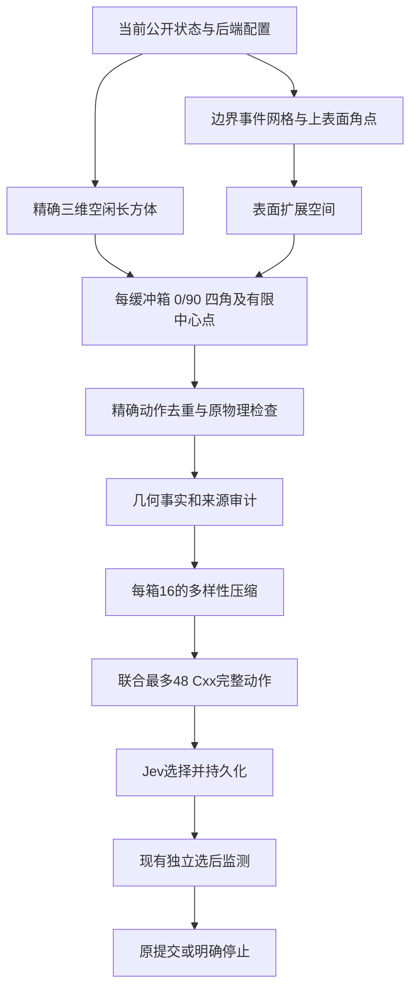

# 几何候选器PCT与GOPT融合改进方案

日期：2026-11-16（Asia/Shanghai）  
设计版本：`geometry_candidate_upgrade_design_v1`  
工程根：已有 `NBU_Papper/`；下文工程路径均相对此根。  
用途：交开发端实施的技术方案。本轮仅编写文档，未改生产代码、构建新候选或启动订单/API实验。

## 1. 决策与目标

保留现有 `e2_original_v1`，新增独立候选后端，采用：

**PCT式三维空闲空间构造与多角点放置 + GOPT式表面角点空间补充 + 原物理检查 + 有限、多样的精确动作输出。**

这里的“融合”是本项目的新设计，不是复现原论文完整算法。PCT/GOPT的策略网络、训练器及原始稳定性过滤均不引入。新候选器只提出“当前缓冲中的哪一箱、以何朝向、放在何精确位置”，最终由Jev独立选择，随后经过现有选后监测。

目标按优先级为：

1. 候选位置符合现有坐标、物理、支撑和包装承载合同，精确动作可直接提交。
2. 提供有意义的位置差异：同箱不同角点、不同支撑层、不同支撑对象及不同空间利用方式。
3. 在每箱16、联合最多48的相同展示预算内，减少重复或高度相似候选挤占名额。
4. 保留候选来源和压缩过程，能解释新旧候选差异，而非只给一个总分。
5. 允许后续公平比较旧E2与新后端，分别判断候选覆盖变化、执行表现及Jev行为变化。

“更合理”不定义为候选越多越好，也不要求新后端必须胜出。工程正确、几何覆盖有变化、完整订单有收益是三件事，分别验收。候选器仍是有限采样器，不宣称全局完备或最优。

## 2. 已核实基线及证据边界

编制时HEAD：`c21943bc6b878f8fd739ce15823da298e510ff81`；进入时工作区和暂存区干净，只发现根 `AGENTS.md`，未发现子目录附加规则。开发端应重新记录自己的进入HEAD和已有修改，不要求回退到本文HEAD。

### 2.1 当前代码确实实现的链路

| 位置 | 已实现行为 | 对本次改进的含义 |
|---|---|---|
| `jev_select/candidates.py::CandidateProvider.build` | 清理当前公开状态；逐缓冲箱调用E2；独立几何复核；打包联合候选；后端名固定为`e2_original_v1` | 新增后端需要显式路由，不能仅替换一个函数 |
| `o4/extensions/e2/candidates.py` | 基础边界点、公开区域点及0/50/100 mm间隙点；按方向/间隙代表与几何分数压缩至每箱16 | 包装路线区域为空；已有部分贴边点，新方案不保证每个状态都有新增位置 |
| `planner/constraints.py::candidate_points` | 枚举地面和已放箱顶高度；组合容器/箱体边界坐标 | 名称虽带EMS风格，未维护真实三维空闲空间集合 |
| `planner/constraints.py::evaluate_pose` | 边界、碰撞、总载荷、70%支撑、中心落实际接触矩形、stackable、面积分载及包装承载；生成几何特征 | 直接复用，不为新后端更改阈值或物理语义 |
| `evaluation/geometry_oracle.py::check_candidate` | 不导入候选器的独立检查；支撑等判断与生成器有各自容差 | 两者都通过才可输出；差异需报告，不能顺手统一容差 |
| `jev_select/config.py::generator_config` | 无参读取`generator_v1.json`；锁定TopK16和0/90 | 保留旧入口，给新后端新增配置解析入口 |
| `o4/extensions/e2/protocol.py::validate_candidates` | 每箱≤16、联合≤48、0/90、精确pose和当前可见箱体检查 | 首版保持这些限制，不扩候选预算 |
| `jev_select/packaging_runtime.py::public_facts/build_context` | 显式投影现有几何、支撑、载荷变化到Choice请求 | 新bundle添字段不会自动进入Jev请求；信息增强需独立接入 |
| `jev_select/episode.py::decision_inputs` | 固定调用旧配置入口，并直接读取E2缓存统计 | 后端路由、计时及缓存统计必须一起适配 |
| `jev_select/execution.py::commit_physical`、`o4/buffer/buffer_state.py::place` | 绑定选择，复核并精确提交 | 复用，不新建订单引擎 |
| `jev_select/stability/exact_adapter.py` | `pct_exact_pose_network_v3`按精确最终位置建接触网络 | 保持选后调用；不得因新空间描述重落箱或移动z |

本表源码路径前缀均为 `semantic_pallet_planner/src/semantic_pallet_planner/`。当前几何评分为紧凑性0.35、高度0.25、支撑率0.25、重心平衡0.15；评分中的`stability`只是支撑率，不是PCT监测结论。

### 2.2 已有报告、归档与本轮未做事项

- [精确位置稳定性修复报告](../../03_阶段产出分析/Jev/Jev_JN4精确位置稳定性修复与29项补充实验验收_20261106.md)说明v3已独立版本化，旧v2与历史反例保留。本文核对了入口代码，未重算稳定性结果。
- [F-S地板工程报告](../../03_阶段产出分析/Jev/Jev_JM-REV1_F-S地板几何工程验收_20261116_01.md)对应的`packaging_fs_geometry.py`确实是保存状态的描述分析器，不是在线候选器，不能将其现有权限或输出直接当作新候选资格。
- [D0保存结果差异盘点](../../03_阶段产出分析/Jev/Jev_JM-D0现有来源保存结果差异盘点验收_20261116_01.md)及其[handoff](../../../semantic_pallet_planner/outputs/JEV_JM_DESC_D0_20261116_01/handoff.json)、[诊断计划](../../../semantic_pallet_planner/outputs/JEV_JM_DESC_D0_20261116_01/diagnostic_plan.json)已存在；保存材料可作为后续同状态工程比较的定位入口，不将其历史几何差异当成新候选收益。
- [D2A质检](../../03_阶段产出分析/Jev/Jev_JM-D2A独立质检与D2B导入验证工程准入_20261116_01.md)及[交接](../../../semantic_pallet_planner/outputs/JEV_JM_DESC_D2A_QA_20261116_01/handoff.json)仍保留历史导入/研究停点。新几何路线不自动解除该路线的执行限制。
- 本轮只读核对源码、相关报告和上述定位材料；未逐文件重验历史manifest，未跑生产测试、候选生成、LP、模型或完整订单。后文所有新接口、版本、命令与验收均为拟议。

## 3. 改进动机与不改的边界

现有候选器的问题是假设与设计限制，不预先认定为代码错误：边界坐标笛卡尔组合会产生许多随后被拒绝的位置；固定间隙采样未直接表示剩余空间尺寸；最终16个槽位可能被相近布局占据；几何评分也不能充分解释剩余空间形状。另一方面，现有候选可能包含新EMS方案遗漏的接触、局部悬挑或间隙位置，因此必须保存旧模块并实测差异。

本方案首版范围：轴对齐0/90、当前可观察箱体、缓冲容量3、原物理准入、原包装合成承载属性、现有精确位置选后监测。

不做：视觉感知接入、机械臂路径规划、顶落可达性硬过滤、六面翻转、摩擦/变形/冲击/真实坍塌模拟、原物理阈值调整、训练、自动T/E提炼或旧记忆迁移。三维空闲不代表机械臂可达；高度图可见不构成新物理准入条件。

禁止在候选生成、排序、压缩和请求投影中调用稳定性内核、读取旧监测标签/反力，或使用未来箱体、整单见证、旧分支收益。允许复用原面积分载检查和当前公开承载事实；这与选后PCT反力是两套不同机制。

## 4. PCT与GOPT各取什么

外部来源核对日期：2026-11-16。PCT公开参考HEAD为`5e7b4238b18310af4529e0f85157d17de605850c`，GOPT为`a2e42de1c0ab62c5e0a356e363349c32beb9e05b`。本地第三方目录不据此自动同步，不声称其字节与这些HEAD相同。

| 来源 | 吸收的机制 | 本项目的调整 |
|---|---|---|
| [PCT GENEMS/Difference](https://github.com/alexfrom0815/Online-3D-BPP-PCT/blob/5e7b4238b18310af4529e0f85157d17de605850c/pct_envs/PctContinuous0/space.py#L458-L528) | 根据已放箱体构建空闲长方体、去重和包含消除 | 纯函数从当前状态重建，先不维护跨步可变缓存；保留下方空隙的六向切分是项目新设计，区别于上游五向剩余空间 |
| [PCT EMSPoint](https://github.com/alexfrom0815/Online-3D-BPP-PCT/blob/5e7b4238b18310af4529e0f85157d17de605850c/pct_envs/PctContinuous0/space.py#L530-L568) | 每个空间按箱体尺寸实例化底面四角位置 | 只保留0/90；精确高度逐项检查，不调用原虚拟稳定性过滤 |
| [GOPT III-B](https://arxiv.org/html/2409.05344v2#S3.SS2)及[ems.py](https://github.com/Xiong5Heng/GOPT/blob/a2e42de1c0ab62c5e0a356e363349c32beb9e05b/envs/Packing/ems.py) | 从表面高度变化角点扩展空间；六坐标表达空闲空间；有界候选 | 用箱体边界事件网格表达精确上表面，不做每毫米栅格化；作为补充来源，不覆盖三维几何；不照搬单角点与低层优先截断 |
| 现有工程 | 原物理检查、支撑/载荷事实、有限Choice候选、恢复与指标 | 全部复用；新后端独立版本化 |

取PCT几何机制并不表示采用其原递归稳定性算法；上游缺陷及本项目全局平衡修正仍按[既有验收](../../03_阶段产出分析/O4/Jev_J4_PCT多支撑分流修正与验收_20261103.md)保留。

## 5. 新候选器数据流



旧后端作为独立路径，经同一公共provider与运行器输出。新后端不得在空池或超预算时偷偷切回E2；如未来增加“新旧原始点合并”模式，必须另外命名、冻结并比较，不计入本方案首版主后端。

### 5.1 坐标、数值及输入

- 公共坐标保持托盘中心为x/y原点、z从地面向上；内部角点为`[x0,y0,z0]`，对外pose仍为底面中心`x_mm/y_mm`与`z_base_mm`。
- 空间统一表达`[xmin,ymin,zmin,xmax,ymax,zmax]`，与`geometry_oracle.bounds`交替端点顺序不同，必须用具名转换，禁止直接复用列表索引。
- 从当前箱体pose和定向尺寸恢复AABB；不从旧`ems_id`恢复空间。新增候选只用地面或当前箱顶的z，不自行下落、抬升或吸附。
- 首版发布坐标粒度保持现有输出的0.001 mm。先精确形成提案，再规范化为拟发布pose，随后用规范化pose重新调用原检查。若规范化改变接触高度或使提案越界/碰撞，记录`POSE_REPRESENTATION_REJECTED`并拒绝，不能用取整扩大支撑或挤进间隙。
- 有限数、正尺寸、ID唯一、原状态无交叠等前置条件检查失败为技术错误。负零规范化；不使用“1 mm内视为同一动作”去重。

### 5.2 PCT式三维空闲空间核心

首版以从当前状态确定性重建为准，不引入额外持久化空间账本：

1. 初始空间为整个容器AABB。
2. 将已放箱体按几何边界的规范顺序处理；不改运行状态的提交顺序。
3. 对每个与箱体正体积相交的空间E，计算交集I，从E生成I左、右、前、后、下、上六个剩余长方体。各剩余体可互相重叠，但不得包含I内部；去除零尺寸体。
4. 去重后，删除完全包含于其他空间的体；相同体先去重，不能让重复空间互相删除。
5. 最终逐体核对容器包含及与全部已放箱体无正体积相交；规范排序，生成由边界决定的`space_id`。

实现时六向剩余体采用“全截面slab”而非把空间切成互不重叠的小格：若E边界为`(ex0,ey0,ez0,ex1,ey1,ez1)`、I为`(ix0,iy0,iz0,ix1,iy1,iz1)`，则分别以`xmax=ix0`、`xmin=ix1`、`ymax=iy0`、`ymin=iy1`、`zmax=iz0`、`zmin=iz1`替换E对应的一项边界，其余五项保持E边界。只在I有正体积时切分；无相交则原样保留E。这样覆盖E去除I后的区域，同时允许剩余体相互重叠。

六向切分保留精确位置模型中的下方空隙，不因借鉴上游就引入“只能从顶部下落”的新限制。空闲集合允许重叠，空间体积之和不是剩余自由体积，禁止据此评分。

称该结果为`EMS_STYLE_3D`空间提案集合：包含消除仅保证当前集合内部无包含冗余，不宣称枚举了所有全局最大空闲长方体，亦不保证每个可行箱体都完整包含于某一提案。首版不以箱体最小边长剪除空间，避免当前小箱/未来未知箱的隐含偏置。

### 5.3 GOPT式表面补充，保留精确几何

目的：给纯三维切分可能碎片化的空间增加较宽的跨表面提案，而非再造物理模拟器。

1. 收集容器及所有已放箱体的x/y边界，形成不等宽事件单元。单元内部上表面高度为覆盖该单元的箱顶高度最大值，无箱则为0。坐标采用实际毫米值，不随容器尺寸生成每毫米数组。
2. 在事件单元的x/y邻域高度变化及容器边界识别角点；枚举四种向内象限，角点高度取相应种子单元高度。只使用原高度图角点，首版不实现上游额外的stair变换。
3. 从种子单元矩形出发，尝试x后y、y后x两种轴序。沿固定负向再正向贪心扩展到事件边界，新增区域必须全部满足`surface_height <= seed_z`；完成轴序后不循环优化，保证结果确定。
4. 每个结果形成`[xmin,ymin,seed_z,xmax,ymax,container_height]`，去重并记录`SURFACE_CORNER`来源。同边界空间可同时保留两类来源。
5. 表面空间还需用精确三维AABB检查为空。上表面较低的单元不等于当前箱底有支撑；支撑仍由后续原检查确定。

上表面投影会丢失悬空箱下方空腔，所以不能成为唯一空间来源，也不能用它删除三维空间产生的候选。事件网格只做提案，不生成稳定/承载标签。

### 5.4 从空间生成精确动作

逐缓冲箱、逐0/90朝向，在空间尺寸允许时提出底面四角及一个中心，共至多5点：

```text
(xmin,   ymin,   zmin)       (xmax-l, ymin,   zmin)
(xmin,   ymax-w, zmin)       (xmax-l, ymax-w, zmin)
((xmin+xmax-l)/2, (ymin+ymax-w)/2, zmin)
```

中心点是本项目补充，便于提供居中、跨支撑位置；不是稳定保证，也不替代四角。只保留`zmin`属于地面/箱顶高度的点。不在空间内连续搜索，不做角点偏移、固定50/100间隙扩展或未来箱体探测。

两来源提案先按`pick_item_id + 定向尺寸 + yaw + 发布后的精确pose`合并，合并全部来源和host space引用。规范化后重新检查host是否完整包含箱体，去除不再包含的引用；失去全部host则按表示拒绝记录，不能输出错误的空间净距。方箱的0/90暂保留为不同朝向动作，与旧合同一致；几何等价量另行统计。重复来源不能占多个候选槽位。

对每个唯一动作依次执行：`evaluate_pose` → 以发布pose复核 → `check_candidate`。前者拒绝按原原因计数；前者通过而独立检查失败，记`PHYSICAL_CHECK_DISAGREEMENT`并终止本次生成，不能悄悄删掉后继续。输出的候选中`physical_valid`只指原准入，不是监测STABLE。

### 5.5 空间事实与多样性压缩

先完成唯一动作的原物理筛选，再压缩。主比较保持每箱16、联合48，不采用GOPT的80空间预算。

可计算事实包括：host空间边界/尺寸、当前箱在host中的各方向净距、地面/上层、直接支撑ID集合、支撑率、局部中心余量、放后高度、现有几何评分。host空间只是当前提案，不声称是动作周围最大的可用空间。一个动作有多个host时保留审计列表；显示代表取最小体积host、再按边界字典序，禁止按“最好看”选描述。

首版不新造收益加权分：原几何分数用于组内排名和同分打破，多样性按下列确定规则选择：

1. 每个非空`(yaw, floor/upper)`组先保留几何分数最高者，最多4个；同分用动作坐标键，不用箱体ID哈希或Cxx。
2. 为每个动作建立分组键：朝向、精确z层、中心所在四象限（坐标0归非负侧）、支撑ID集合（地面为GROUND）、来源类型。去重动作可覆盖多个来源键。
3. 在剩余动作中贪心选覆盖“尚未出现分组键”数量最多者；同分依次按原几何分数降序、动作键升序。不得附加PCT分数或旧收益。
4. 全部分组键已覆盖后按原几何分数补齐到16；候选少于16全部返回。

除第1步外，不保证所有层/支撑对象都能入选。审计保留原始有效池、最终池的分组覆盖以及被压缩数量，让开发端能定位“没生成”和“生成后丢失”。TopK是正式选择子集限制，不把候选截断误记成几何无解。

## 6. 有界计算、失败及恢复

首版建议默认上限如下，GP0可根据当前已放箱数和输入规模一次性调整并冻结，不能依据Jev成绩调整：

| 计数 | 初始设计值 | 超限语义 |
|---|---:|---|
| 单状态活动空间数量 | 4096 | `GEOMETRY_BUDGET_EXCEEDED` |
| 单状态空间包含比较次数 | 2000000 | 同上 |
| 表面事件单元数 | 16384 | 同上 |
| 表面矩形扩展的单元检查次数 | 2000000 | 同上 |
| 每箱原始点尝试数，含去重前 | 32768 | 同上 |

所有分支和中间结构都计入相应预算，不能只限制最终输出。限额是工程资源边界，不是物理容差；首版超限整个新后端返回ERROR，不输出部分池，不降级到旧后端。墙钟时间仅记录，不作为影响候选内容的截断条件。最终manifest必须记录实际冻结数值。

正常完整枚举后无有效点为`OK_EMPTY`；独立检查不一致、非法输入、数值异常、超预算为`ERROR`，不能变成`STOP_NO_PHYSICAL_CANDIDATE`。新增错误码经公共运行器技术停止路径持久化，不混入预测失稳。

空间和候选生成均不改传入状态。首版不依赖跨步空间缓存；后续如优化缓存，键至少包含公开状态摘要、后端/配置/物理身份，且缓存必须可丢弃重建。

恢复沿用`SELECTED → MONITORED → COMMITTED/TERMINATED`：已存选择不重新选择，已存监测不覆盖，已提交不重复提交。新后端/配置/源码/预算身份变化必须拒绝恢复。旧checkpoint不能改版本号、重签摘要后进入新协议；历史公开状态只可通过独立比较输入适配器使用，不成为新可执行checkpoint。

## 7. 拟议工程位置与接口

### 7.1 新增文件及职责

以下均为建议路径，编制时未实现；开发端可合并小模块，但不得复制订单引擎、物理规则或第三方训练工程。

| 路径，相对于源码包 | 职责 | 阶段 |
|---|---|---|
| `planner/space_candidates/contracts.py` | 空间/动作提案/审计数据结构、坐标转换、预算 | GP0—1 |
| `planner/space_candidates/empty_spaces.py` | 三维六向切分、去重和包含消除 | GP1 |
| `planner/space_candidates/surface_spaces.py` | 精确事件表面、角点和矩形扩展 | GP1 |
| `planner/space_candidates/generator.py` | 0/90四角/中心、原检查复用、来源聚合 | GP2 |
| `planner/space_candidates/reduction.py` | 每箱16的确定性多样性压缩 | GP2 |
| `jev_select/candidate_backends.py` | 旧/新后端注册、配置及统一返回适配 | GP3 |
| `jev_select/configs/generator_ems_surface_v1.json` | 新算法/预算/压缩配置，不替换旧配置 | GP0—3 |
| `jev_select/packaging_geometry_protocol.py` | 独立比较运行配置、身份、准入和公共循环接入 | GP3 |
| `jev_select/geometry_comparison.py` | 同状态与后续整单比较的汇总、动作交并集、绘图数据 | GP4—5 |
| `jev_select/schemas/geometry_*.schema.json` | 新输入、审计、比较计划和结果的封闭Schema | GP0—4 |
| `semantic_pallet_planner/tests/unit/test_space_candidates.py`、`semantic_pallet_planner/tests/unit/test_geometry_backend_integration.py`（本行以工程根计） | 必要几何/路由/恢复验证 | GP1—3 |

拟议接口：

```python
build_spaces(placed_items, container, space_config) -> SpaceIndex
generate_for_item(public_state, pick_item_id, space_index, generator_config) -> GenerationResult
reduce_candidates(valid_candidates, metadata, top_k=16) -> ReductionResult
generate_backend(public_state, observation, backend_config) -> BackendResult
```

`SpaceIndex`仅含当前几何和来源；`GenerationResult`包含原始有效动作及拒绝计数；`BackendResult`含最终候选、分箱计数、审计引用和缓存/计时事实。所有返回值不包含稳定性预测。新后端一个状态的空间索引可供三个缓冲箱复用，不能为每箱重复切分。

### 7.2 必须核对的现有修改点

| 现有位置 | 允许的修改 | 保护要求 |
|---|---|---|
| `jev_select/candidates.py` | 新协议分支读取显式backend；旧版本继续E2；统一bundle验证 | 不改E2生成函数，不改变旧调用默认值；禁止未知后端回退 |
| `jev_select/config.py` | 新增`generator_config_for(config)`之类显式解析器 | 原`generator_config()`保留旧资源与保护语句 |
| `jev_select/packaging_versions.py`、`contracts.py` | 集中登记新协议/Schema并显式路由 | 不放宽旧Schema的const/enum，不用任意后缀自动接受新版本 |
| `jev_select/episode.py` | 新协议接入配置解析/统一计时；复用公共episode循环 | 旧分支仍原行为；缓存命中统计来自实际后端，不读E2缓存冒充新统计 |
| `jev_select/packaging_runtime.py`、`context.py` | 新协议识别及F0/F1显式投影、绑定重建 | 主比较F0不加新字段；不得把候选来源质量标签注入模型 |
| `jev_select/execution.py`、`selector.py`、`evaluation.py`及远程注册 | 必要新版本白名单与结果绑定 | 原检查、选择解析、停单、指标含义不变 |
| `jev_select/stability/monitor.py` | 仅必要的新运行协议准入识别 | 算法/数值/开关/选后调用顺序不变，不修改内核 |
| `experiment.py::source_manifest`、`packaging_runtime.py::physical_manifest` | 新运行身份覆盖新增文件与配置；分开标识物理检查与几何后端 | 新增py/json也会影响现有宽范围源码摘要；即使不改旧函数，旧冻结运行仍可能拒绝恢复，不能豁免或重签 |
| `cli.py` | 独立比较prepare/compare入口，仅在确有需要时新增 | 不复用旧JM许可启动新实验 |

### 7.3 版本、Schema与身份

拟议后端标识：旧`e2_original_v1`，新`ems_surface_hybrid_v1`。几何内部版本使用`geometry_space_index_v1`、`geometry_generation_audit_v1`、`geometry_comparison_v1`。拟议新运行协议为`jev_packaging_geometry_compare_v14`及独立`config/candidate_bundle/decision_context/selection/checkpoint_v14`；开发启动时重新检查v14是否已被其他窗口占用，冲突则集中改名，交付记录最终名称。

新运行协议允许显式选择上述两种后端，其他字段保持统一。旧v1—v13仍锁定原后端。新旧正式主比较必须在同一个新运行协议内运行，不能拿旧历史job与新job直接配对归因。

同时新增`geometry_compare_plan_v1 / geometry_compare_execution_v1 / geometry_compare_run_v1`封闭合同，由`packaging_geometry_protocol.py`统一准备、验证和调用公共循环。它们分别绑定任务矩阵、单job配置/方法/后端/允许发送次数，以及实际状态与账目。新协议方法白名单只含旧/新后端共用的两个本地方法及待授权的`jev_no_memory`；本地执行配置发送次数为0。不要借用要求v13配置和旧execution版本的`packaging_jev_v13.freeze_execution`或历史permit绕过准入；只复用可独立适配的公共账本/运输/检查点机制。新选择结果、检查点、监测绑定、运行汇总的版本识别应一起接通，未支持组合显式拒绝。

封闭Schema最少约束：

- 配置：backend、几何算法版本、0/90、每箱16/联合48、压缩规则、数值表示、预算、`feature_profile`、物理检查及监测身份。
- bundle：原候选/摘要、后端身份、配置摘要、逐箱生成计数；增加受版本约束的`geometry_audit_digest`及侧车元数据引用。候选核心仍使用现有pose/支撑/载荷/几何字段。
- 空间审计：当前公开状态摘要、空间边界/来源、原始点/唯一点/物理有效/最终数量、各类拒绝、预算计数、压缩覆盖、每个最终动作的host引用。耗时不参加语义摘要。
- 比较输入：来源文件/字节摘要、状态适配器版本、公开字段清单、两个配置与源码身份、样本纳入/缺件理由；不能把原有历史输出摘要改造成新输入摘要。
- 比较结果：每个状态/箱体的动作交并集、归因到生成或压缩的差异、分母、技术错误、未运行及图表引用。

新候选ID建议由`backend_version + observation_digest + semantic_action_key`生成，Cxx仍为展示别名。新旧跨后端匹配只用语义动作键，不用candidate_id、ems_id或Cxx。现有`evaluate_pose`生成的`ems`字段属于兼容标签；真实空间边界保存在新侧车中，不能把旧标签冒充真实EMS。

新协议的`physical_candidates`继续表示TopK后的原物理准入池，`selectable_candidates`须完全等于它。几何原始有效池使用独立名字`raw_valid_candidates`，不混淆为所有物理可行动作。

### 7.4 Jev信息投影：F0优先，F1后置

- `F0_existing_facts`：主比较必做。新旧后端统一使用现有问题、字段、匿名映射方式和展示种子；仅候选动作集合变化。后端名、来源、压缩理由、离线比较结果不进入请求。
- `F1_space_facts`：可选独立阶段。才将空闲空间边界、尺寸、净距等事实提供给Jev。必须对新旧动作运行同一个公开几何描述器；旧动作无合适host时显式NA，不能伪造空间，也不能给新后端更多描述来冒充纯候选增益。

F1使用单独feature/prompt版本及请求摘要，不与F0混报。首版不做“放后最大空闲空间”“未来可装箱数”“剩余承载求和收益”等昂贵或含混指标。F-S诊断可作为参考，但现有F-S合同限地板与保存字节，若复用需新增适配协议，不直接扩大旧接口。

F0保持现有按动作坐标规范排序再洗牌的展示方式，并检查seed所用的request_id/state_hash在同状态比较中一致，不把backend、job名称或候选ID加入种子。不同候选池不保证共同动作拿到同一个Cxx，比较只能通过动作键匹配；轨迹分化后不要求展示一致。`max_request_bytes`首版保持现有96000字节上限，超出按技术错误停止，不静默删候选或裁剪事实。

## 8. 分阶段实施与验收

本文不授权自动实施或实验；开发端收到明确实施任务后按阶段交付。GP0—4构成首轮“新候选器工程及同状态区别”交付；GP5—6是后续可选比较，不作为首轮完成前置。无需每个阶段再设独立人工审批窗口，但不能越过技术失败继续，也不能把本方案当作付费调用许可。

| 阶段 | 目标与改进位置 | 最小交付 | 验收目标/退出条件 |
|---|---|---|---|
| GP0 基线与合同 | 冻结旧后端输出合同、新配置、数值/预算、输入清单与版本；检查上述集成点 | `baseline_inventory`、新协议草案、`comparison_plan` | A00：旧源码/配置摘要可定位；样本与缺件明确；旧/新身份及F0分离；无历史改写。完成后进入GP1 |
| GP1 空间几何 | 新增三维空闲空间与表面补充两个模块 | 空间索引、少量构造图及实际计数 | A01：输出体均在容器内且不穿占据物；重复/包含处理正确；表面不替代三维空腔；输入不变、预算可控 |
| GP2 动作与压缩 | 四角/中心、原检查、去重、每箱16多样性 | 可单独调用的新候选器、原始与最终池审计 | A02：所有输出同时通过原生成检查及独立检查；坐标精确一致；无PCT调用；有界、确定、无重复、≤16/48；必保留组规则成立 |
| GP3 双后端接入 | 独立v14协议、provider/config/context/运行器身份与恢复接入 | 两后端在公共循环内可用；旧默认不变 | A03：旧兼容调用输出保持；新旧F0同字段；错后端/错配置拒绝；选择→监测→提交顺序及恢复不变。仅构造/本地验证，不真实发请求 |
| GP4 同状态比较 | 固定已暴露保存状态，生成两后端并列几何结果 | 对比JSON/CSV、最多5张状态图、差异分析及交接 | A04：完整分母、动作匹配及生成/压缩差异可解释；负例/空池/ERROR保留；不把覆盖增多写成整单收益。首轮到此停止 |
| GP5 小范围本地整单 | 新协议下相同到货、缓冲、物理与监测；两后端比较 | 最多8个本地job及同版本配对报告 | A05：完整订单无截断；完整指标与技术状态齐全；明确本地策略结果不代表Jev收益。需后续指定执行 |
| GP6 可选Jev/F1 | 先比较F0下无经验Jev；必要时再比较空间信息F1 | 单独冻结模型计划、发送账目和比较报告 | A06：同协议配对、无隐式重试、停止与预算可审计；F0/F1及候选/提示收益分开；无需经验路线胜出。未经后续真实调用指令保持NOT_RUN |

### 8.1 必要检查：控制在小范围

不要求全量历史回放、全仓库测试、随机大规模压力测试或完整消融矩阵。首版必要构造场景控制为以下8类，每类允许少量参数化，不以测试数量作为验收目标：

| 场景 | 要证明的行为 |
|---|---|
| 空托盘＋非方箱 | 四角/中心、0/90、中心/角点转换正确；同坐标来源合并 |
| 贴边凹槽与非整数边界 | 正确尺寸适配、边界贴合；输出规范化不制造可行位置 |
| 两箱同高平台 | 表面空间能跨单箱边界；支撑事实按原规则计算 |
| 高低台阶与上方间隙 | 较高障碍阻止表面扩展；三维空间保留空腔；不偷偷垂直下落 |
| 支撑中空、70%边界、non-stackable | 原支撑/中心/stackable拒绝仍生效，不替换成GOPT的50%快捷规则 |
| 多层承载紧张 | 原面积分载与合成容量拒绝不变；不调用PCT预评 |
| 超16有效位置、三箱缓冲 | 压缩分组、去重、每箱16/联合48和完整审计成立 |
| 超预算、检查不一致及恢复中断 | ERROR不变空池；错身份拒绝；选后监测只针对已选动作，保存结果复用且不重复提交 |

旧路径验证只选现有相关几何/provider检查及少量构造状态；若声明旧输出一致，应比较完整候选语义/顺序/摘要，不比较elapsed时间。新增共享路由导致的失败修复后再跑受影响检查，不反复扩大测试。

开发端使用当前已有可用解释器，缺依赖先报告实际环境，不为写方案安装依赖。拟议命令形态（文件实施后才可执行）：

```bash
PYTHONDONTWRITEBYTECODE=1 PYTHONPATH=semantic_pallet_planner/src python3 -m pytest semantic_pallet_planner/tests/unit/test_space_candidates.py semantic_pallet_planner/tests/unit/test_geometry_backend_integration.py
git diff --check
```

GP3的监测测试可用构造动作与有限真实内核检查，次数按上述语义需要限定；GP0—2/4几何模块比较不运行稳定性求解，不进行全候选LP扫描。历史报告中的测试结果不能当本次已通过。

## 9. 新旧候选器对比方案

### 9.1 主比较：同状态、同预算、零模型调用

候选标签：`OLD_E2`与`NEW_EMS_SURFACE`。两者使用同一当前状态、相同缓冲箱和0/90、原物理规则、每箱16/联合48、F0。旧E2保持原压缩规则，新后端使用本方案压缩规则；主结果因此是“整个候选后端”的比较，不单独归因于EMS。

优先使用既有5个已暴露状态：`P01_ffcfcc6e4af4`、`P02_f17e03ef6116`、`P03_81c78da5f3a7`、`P04_53bacc63aa29`、`P05_392be366b95d`。具体来源从[保存输入清单](../../../semantic_pallet_planner/outputs/JEV_JM_REV1_FS_ENGINEERING_20261116_01/saved_input_inventory.json)和其指向的原公开prefix/pool定位；不按旧胜负挑选，不扩展到所有历史决策。

**输入完整性要求**：F-S投影只含几何，不足以运行完整物理检查。GP0必须从原公开observation/保存状态中取得质量、stackable、承载参数、已放箱载荷/支撑、缓冲顺序与容器；若字段缺失，使用有证据的同状态公开来源适配，禁止猜测或以默认0/默认容量补齐。缺件状态记`NOT_COMPARABLE_MISSING_INPUT`并留在5个分母，不自动增加替代状态。历史包只读，新输出放新目录。

每个状态至少输出：

| 指标 | 定义与边界 |
|---|---|
| 提案/有效/最终数量 | 分箱列明；E2的attempt计数和新后端计数口径分列，不强行直接相减 |
| 动作交集、OLD_ONLY、NEW_ONLY | 用精确语义动作键；方箱朝向等价另外列出，不把不同Cxx当新增位置 |
| 新增/丢失位置图 | 标明箱体、坐标、yaw、z、支撑对象和来源；不标“最佳/稳定” |
| 表面补充净贡献 | 相对于三维空间提案的原始有效新增动作；只读集合分解，不额外跑订单 |
| 压缩覆盖 | 原始有效池与最终池的高度层、支撑集合、朝向、水平位置组；哪些新点被TopK丢弃 |
| 最小放后高度、最高支撑率、几何分数范围 | 候选集合描述指标，不能把各项最优组合成不存在的一个动作 |
| 旧动作保留率 | `count(OLD∩NEW)/count(OLD)`，旧池为空时NA；不设100%硬门槛 |
| 新动作比例 | `count(NEW_ONLY)/count(NEW)`，新池为空时NA；不是越高越好 |
| 时延/预算/请求大小 | 冷调用与缓存分开；小样本列原值、中位数/最大值，不强求p95；字节数只构造不发送 |
| 异常与空池 | `OK_EMPTY/ERROR/NOT_RUN/NOT_COMPARABLE`分别计数，保留逐箱及状态完整分母 |

同状态图应包含俯视及必要侧视，统一比例和颜色规则；最多每状态一张组合图，不逐候选生成海量图片。结论回答“哪些位置增加/丢失、是否通过相同检查、是否只是压缩不同、代价如何”。如果五状态没有明显差异，也如实交付，不追加数据寻找改善。

可额外在已保存原始有效池上运行一次共同压缩器，作为区分“点生成”与“压缩”影响的离线解释。该结果需单独标`DIAGNOSTIC_COMMON_REDUCER`，不改变OLD_E2主基线；若旧原始池无法取得，直接NOT_AVAILABLE，不修改旧生成函数强行取池。

### 9.2 后续小范围完整订单比较

仅在GP4交付后、用户指定开展本地整单时执行GP5。首批最多2个已有已暴露训练来源订单，按冻结train清单的task_id字典序选取首2个资料完整者，记录纳入理由；不得按新后端成绩挑选。两后端×两个本地方法（`local_geometry_test_double`、`local_first_test_double`）×两订单，最多8job，不加种子重复。

各job从相同初始订单开始，调用现有公共`run_episode/commit_physical`与同一`pct_exact_pose_network_v3`。不同后端轨迹分化后，不强求每步候选或状态相同；不把轨迹差异当同池反事实。local_first依赖候选输出顺序，只作顺序敏感性对照；local_geometry只作公共几何分数基线，两者都不称Jev。

冻结到货、缓冲、箱体属性、原物理、监测、容器、候选预算和展示配置，只改变backend及其必需身份。指标复用现有完整订单合同：完成、件数/体积/质量装入比、固定容器利用率、垛高、包络利用率、预测失稳进度、不可评价/技术失败、候选生成和选择时延。纯本地费用为无服务调用NA，不把历史UNKNOWN覆盖成0。未实现指标显式NOT_IMPLEMENTED。

采用装入量优先、同装入量再讨论布局的既有评价口径；技术错误和不可评价不强行排名。局部收益不推断未见来源泛化；相同订单全装入时固定容器利用率相同不能证明布局改善。完整订单也不得无声按event_limit截断。

### 9.3 可选Jev比较及信息增强

GP6先做F0下`jev_no_memory`，仍最多2订单×2后端=4job，不复用旧真实响应来冒充新选择，不同时引入T/E。正式运行前单独冻结实际task_id、模型/提示/依赖/新运行身份、每job发送上限及停止规则；可用完整箱数作为每job最大发送次数上界，单候选不发送，真实账目按实际记录。此处是未来设计，不是当前付费矩阵授权。

F1只在确需检验空间描述价值时另立小矩阵，先固定一个后端再比较F0/F1，避免一次改变后端和提示。原经验库、历史卡及适用条件不能默认迁移到新候选协议；经验研究另行指定，不阻塞首版几何工程交付。

## 10. 验收判定与交付

### 10.1 必须通过的工程条件

1. 旧E2源码/配置/默认路由保留，新后端显式选择，未知/失败不回退。
2. 新输出全部通过原物理检查，精确pose与提交一致；输入状态无修改，候选无未来/私有信息。
3. 同一公开状态和配置得到相同语义输出、顺序和摘要；确定性不依赖墙钟时间或Python哈希顺序。
4. 每箱≤16、联合≤48；原始有效池与展示池区分；来源合并及压缩过程可说明。
5. 不运行PCT预评、不输出监测标签给选择器；原选后监测、终止及恢复合同保持。
6. 新后端/配置/源码/数据身份冻结，旧冻结运行不得重签。新旧主比较共用新协议与F0。
7. GP4五状态完整分母、缺件、空池、负例和ERROR均保留，完成可阅读差异报告。

任何关键项失败不得用统一总PASS覆盖。输入缺件可将GP4标PARTIAL，不能伪造数据。几何/集成工程完成但没有收益，可记`ENGINEERING_COMPLETE / BENEFIT_NOT_ESTABLISHED`；如果新后端丢失关键可行位置、成本明显不合适或局部整单普遍退化，应维持旧默认并交付原因，不以“新算法”名义强制替换。

不设置“必须增加X%候选”“装入量必须提高Y%”等无依据门槛。新后端完成的验收目标是正确、可接入、可比较；是否提升研究表现由后续冻结比较回答。

### 10.2 产物及文档位置

实际开发按阶段新建 `semantic_pallet_planner/outputs/GEOM_CANDIDATES_<阶段>_<日期>_<序号>/`，不覆盖旧outputs或同名产物。最少保存：

- `handoff.json`：进入/交付HEAD、工作区已有修改、完成阶段、最终协议名、下一阶段与停止条件。
- `source_manifest.json`、`config_snapshot.json`、`input_manifest.json`：当前源码/配置/输入身份及公开字段来源。
- `checks.json`：逐验收A00—A06的PASS/FAIL/PARTIAL/NOT_RUN、实际命令、解释器、证据路径；只记录实际检查。
- `comparison_plan.json`、`comparison.json/csv`、必要空间/动作审计及≤5张图：同状态比较阶段交付；后续订单结果独立目录。
- `delivery_manifest.json`：交付文件摘要；耗时、环境与语义摘要分开。

原始有效池的逐动作完整导出仅要求GP4固定五状态；后续整单默认保存逐步计数/覆盖及最终候选来源，不强制保存每次原始拒绝的完整记录。这样保留诊断能力，同时避免无必要的产物膨胀。

阶段报告建议放 `docs/03_阶段产出分析/几何规划模块/`，首次实际交付再创建目录与索引；本目录维护实施方案索引。保留旧O4/Jev所有报告原位。

### 10.3 开发端启动顺序与停止条件

开发端先读根AGENTS、本方案、适用子目录规则，再核对当前HEAD/工作区、表2.1实现、精确监测报告及GP0输入来源；不要重新克隆、更新第三方、读取凭证或下载权重。版本/模块已被其他窗口新增时先协调复用，不覆盖未提交工作。

建议首个开发任务明确限定为 **GP0—GP4：完成新后端、公共路由、必要构造检查及五状态零调用比较**。如果任务仅指定其中某阶段，则完成指定阶段后停止。完成GP4不自动进入GP5/GP6，不默认切换生产/研究默认候选器，不自动commit/push。

本文本次交付状态：`DESIGN_ONLY`。新候选器`NOT_IMPLEMENTED`；新旧候选比较`NOT_RUN`；整单/Jev收益`NOT_ESTABLISHED`。
