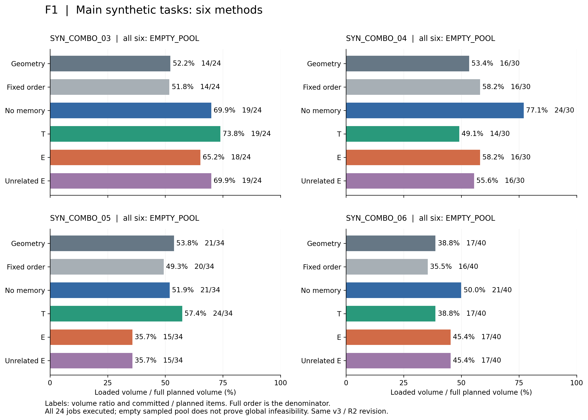
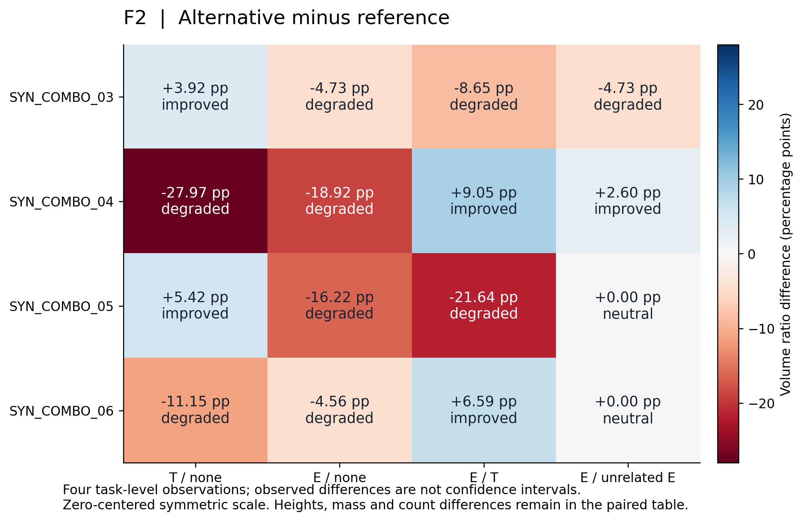
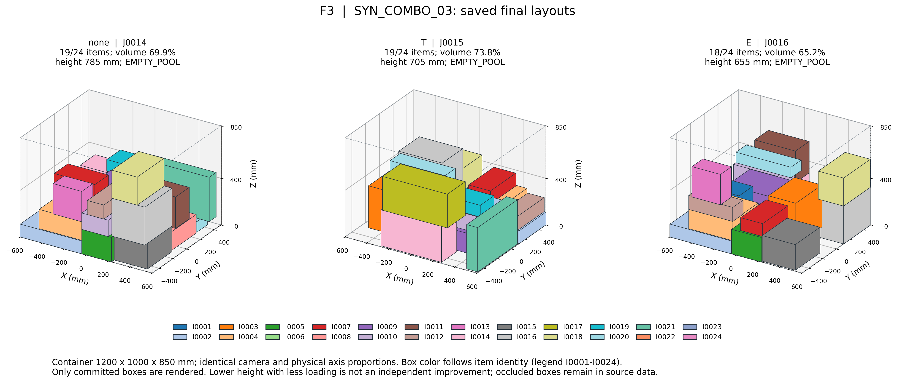
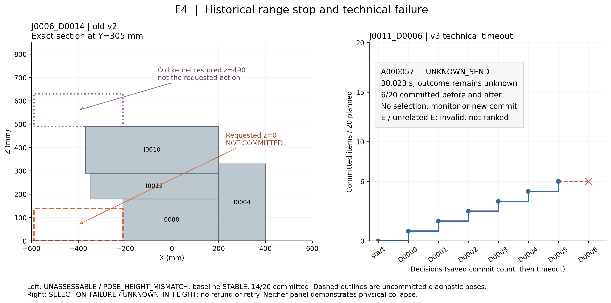

# Jev JN5合成路线限定分析与证据整理验收

日期：2026-11-07。进入 HEAD `e9a99fc7`（已同步JN5方案；方案原基线 `2b8a8042`）。**JN5合成路线限定分析交付完成；P01—P04均在本限定范围完成。研究收益仍为 `NOT_ESTABLISHED`。**

本轮只对已保存JN4结果做离线计算、绘图、证据整理和检查。最终包为 `JEV_JN5_ANALYSIS_20261107_03`；开发包01/02及对应报告保留，最终包修正相对路径与复现时附带检查记录的复制，旧开发包不作为最终验收入口。冻结分析范围、指标及原始结果不变。新增模型调用、正式订单、分叉、训练、经验生成、凭证读取均为0；未联网调用模型、未重跑轨迹或全量validate-run、未启动子代理、未commit/push。已有未提交的JN4方案、可视化文档、两份索引增补、原始数据和展示目录均保留。本报告只新增JN5结果和索引入口，未改生产实现、冻结数据、T/E、历史运行包及历史报告。

依据[JN5方案](../../02_阶段实施方案/Jev/Jev_JN5合成路线限定分析与证据整理方案_20261107.md)与[主规范9.6及公共指标合同](../../02_阶段实施方案/Jev/Jev新数据完整订单与经验增强分阶段开发规范_20261103.md)。[分析范围](../../../semantic_pallet_planner/outputs/JEV_JN5_ANALYSIS_20261107_03/analysis_scope.json)在新指标计算前保存，类型为 `POST_HOC_FROZEN_RESULT_ANALYSIS`，不是原实验事前预注册。[消费输入摘要](../../../semantic_pallet_planner/outputs/JEV_JN5_ANALYSIS_20261107_03/input_manifest.json)与[证据索引](../../../semantic_pallet_planner/outputs/JEV_JN5_ANALYSIS_20261107_03/evidence_index.json)登记仓库相对路径、SHA256、job/decision/attempt与JSON指针。

## 证据层与分组

报告声明：JN4报告声称36槽位已收尾及累计账目。代码实现：本轮仅新增独立离线入口，按原函数AST选取纯评价函数，未导入工程运行模块；冻结 `jev_branch_comparison_rule_v2` 的优先级、阈值及标签保留，函数摘录和完整规则归档。归档证据：原task、metrics、status、layout、请求账本及固定案例动作/检查点均存在。本机复验：重算完整订单分母、提交布局对应量、24个主槽位身份、16对差值与评价、历史配对有效性、账目及图表证据；不声称本轮重新运行历史模型或静态内核。

| 层 | 范围与身份 | 本次用途 |
|---|---|---|
| 主分析 | SYN_COMBO_03—06，4任务×6方法，R2，同v3、同源码manifest | 逐任务及任务等权汇总；16对 |
| 部分补充 | SYN_COMBO_02，R1五项v3；几何是R0旧v2 | 同v3有效部分比较；无关E超时配对无效 |
| 历史展示 | SYN_COMBO_01，R0旧v2完整六方法 | 单列，不进入主均值 |
| 工程覆盖 | 全36槽位 | 保留6 COMPLETE、28 EMPTY_POOL、1 UNASSESSABLE、1 SELECTION_FAILURE；0 NOT_RUN |

R0=`JEV_JN4_SYNTH_EXEC_20261105_01/run`，R1=`JEV_JN4_EXACT_20261106_01/run`，R2=`JEV_JN4_REMAIN24_20261106_01/run`，均位于 `semantic_pallet_planner/outputs/`。逐行算法、协议、源码manifest及run见[全36索引/指标CSV](../../../semantic_pallet_planner/outputs/JEV_JN5_ANALYSIS_20261107_03/all_36_metrics.csv)与[JSON](../../../semantic_pallet_planner/outputs/JEV_JN5_ANALYSIS_20261107_03/all_36_metrics.json)。主矩阵只有4个任务级观测，任务共享原型；24方法槽位、箱体、请求、共享SKU均不是独立样本。

## 主结果与配对

所有24个主槽位均为 `EMPTY_POOL`，完整完成0/24；自然候选空池表示冻结采样池为空，不表示未执行或证明全局无解。件数、体积和质量比例以完整订单为分母，未到货箱体仍在分母，失败尝试不计已装。下表为保存布局复算后与原metrics一致的结果；比例以百分比显示。

| 任务 | 方法/job | 状态 | 件数 | 件数比 | 体积比 | 质量比 | 固定容器利用率 | 高度mm | 包络利用率 |
| --- | --- | --- | --- | --- | --- | --- | --- | --- | --- |
| 03 | geometry/J0012 | EMPTY_POOL | 14/24 | 58.33% | 52.23% | 57.46% | 27.56% | 700.00 | 33.46% |
| 03 | fixed/J0013 | EMPTY_POOL | 14/24 | 58.33% | 51.78% | 64.64% | 27.32% | 815.00 | 28.49% |
| 03 | none/J0014 | EMPTY_POOL | 19/24 | 79.17% | 69.93% | 77.53% | 36.89% | 785.00 | 39.95% |
| 03 | T/J0015 | EMPTY_POOL | 19/24 | 79.17% | 73.85% | 78.34% | 38.96% | 705.00 | 46.97% |
| 03 | E/J0016 | EMPTY_POOL | 18/24 | 75.00% | 65.20% | 77.65% | 34.40% | 655.00 | 44.64% |
| 03 | unrelated_E/J0017 | EMPTY_POOL | 19/24 | 79.17% | 69.93% | 77.53% | 36.89% | 785.00 | 39.95% |
| 04 | geometry/J0018 | EMPTY_POOL | 16/30 | 53.33% | 53.42% | 44.91% | 36.35% | 640.00 | 48.28% |
| 04 | fixed/J0019 | EMPTY_POOL | 16/30 | 53.33% | 58.16% | 48.29% | 39.58% | 830.00 | 40.53% |
| 04 | none/J0020 | EMPTY_POOL | 24/30 | 80.00% | 77.09% | 68.01% | 52.46% | 820.00 | 54.38% |
| 04 | T/J0021 | EMPTY_POOL | 14/30 | 46.67% | 49.11% | 40.01% | 33.42% | 670.00 | 42.40% |
| 04 | E/J0022 | EMPTY_POOL | 16/30 | 53.33% | 58.16% | 48.29% | 39.58% | 740.00 | 45.46% |
| 04 | unrelated_E/J0023 | EMPTY_POOL | 16/30 | 53.33% | 55.56% | 46.89% | 37.81% | 685.00 | 46.92% |
| 05 | geometry/J0024 | EMPTY_POOL | 21/34 | 61.76% | 53.82% | 61.10% | 46.04% | 830.00 | 47.15% |
| 05 | fixed/J0025 | EMPTY_POOL | 20/34 | 58.82% | 49.32% | 51.36% | 42.19% | 810.00 | 44.27% |
| 05 | none/J0026 | EMPTY_POOL | 21/34 | 61.76% | 51.94% | 59.55% | 44.44% | 806.00 | 46.86% |
| 05 | T/J0027 | EMPTY_POOL | 24/34 | 70.59% | 57.36% | 68.85% | 49.07% | 835.00 | 49.95% |
| 05 | E/J0028 | EMPTY_POOL | 15/34 | 44.12% | 35.72% | 35.27% | 30.56% | 565.00 | 45.97% |
| 05 | unrelated_E/J0029 | EMPTY_POOL | 15/34 | 44.12% | 35.72% | 35.27% | 30.56% | 565.00 | 45.97% |
| 06 | geometry/J0030 | EMPTY_POOL | 17/40 | 42.50% | 38.81% | 45.33% | 28.53% | 718.00 | 33.77% |
| 06 | fixed/J0031 | EMPTY_POOL | 16/40 | 40.00% | 35.48% | 40.64% | 26.08% | 768.00 | 28.86% |
| 06 | none/J0032 | EMPTY_POOL | 21/40 | 52.50% | 49.96% | 52.98% | 36.72% | 842.00 | 37.07% |
| 06 | T/J0033 | EMPTY_POOL | 17/40 | 42.50% | 38.81% | 45.33% | 28.53% | 795.00 | 30.50% |
| 06 | E/J0034 | EMPTY_POOL | 17/40 | 42.50% | 45.39% | 44.18% | 33.37% | 842.00 | 33.69% |
| 06 | unrelated_E/J0035 | EMPTY_POOL | 17/40 | 42.50% | 45.39% | 44.18% | 33.37% | 842.00 | 33.69% |

详细[主指标CSV](../../../semantic_pallet_planner/outputs/JEV_JN5_ANALYSIS_20261107_03/main_24_metrics.csv)同时保留不可评价/技术失败标识、监测状态/原因、首次预测失稳进度及精确终止原因。主24项监测共426次STABLE，UNSTABLE/UNASSESSABLE/ERROR均未观察到；它们不是未选候选的稳定性评估。主任务无自然预测静态失稳案例，不据此估计真实坍塌率。

配对方向固定 `delta = alternative - reference`。比例差以百分点（pp）、高度差以mm报告。主要层级为稳定完整完成→体积装入比例→件数/质量Pareto→装入等价时高度/包络Pareto；不另加事后综合权重。全部原值、差值、标签、决定层及反向次要指标保留在[主16对JSON](../../../semantic_pallet_planner/outputs/JEV_JN5_ANALYSIS_20261107_03/main_16_pairs.json)与[CSV](../../../semantic_pallet_planner/outputs/JEV_JN5_ANALYSIS_20261107_03/main_16_pairs.csv)。

| 任务 | 比较 | Δ体积pp | Δ件数 | Δ质量pp | Δ高度mm | 标签 | 决定层 |
| --- | --- | --- | --- | --- | --- | --- | --- |
| 03 | T/none | 3.92 | 0 | 0.81 | -80.00 | improved | LOADED_VOLUME |
| 03 | E/none | -4.73 | -1 | 0.12 | -130.00 | degraded | LOADED_VOLUME |
| 03 | E/T | -8.65 | -1 | -0.69 | -50.00 | degraded | LOADED_VOLUME |
| 03 | E/unrelated_E | -4.73 | -1 | 0.12 | -130.00 | degraded | LOADED_VOLUME |
| 04 | T/none | -27.97 | -10 | -28.00 | -150.00 | degraded | LOADED_VOLUME |
| 04 | E/none | -18.92 | -8 | -19.72 | -80.00 | degraded | LOADED_VOLUME |
| 04 | E/T | 9.05 | 2 | 8.28 | 70.00 | improved | LOADED_VOLUME |
| 04 | E/unrelated_E | 2.60 | 0 | 1.40 | 55.00 | improved | LOADED_VOLUME |
| 05 | T/none | 5.42 | 3 | 9.30 | 29.00 | improved | LOADED_VOLUME |
| 05 | E/none | -16.22 | -6 | -24.28 | -241.00 | degraded | LOADED_VOLUME |
| 05 | E/T | -21.64 | -9 | -33.58 | -270.00 | degraded | LOADED_VOLUME |
| 05 | E/unrelated_E | 0.00 | 0 | 0.00 | 0.00 | neutral | COMPACTNESS |
| 06 | T/none | -11.15 | -4 | -7.65 | -47.00 | degraded | LOADED_VOLUME |
| 06 | E/none | -4.56 | -4 | -8.80 | 0.00 | degraded | LOADED_VOLUME |
| 06 | E/T | 6.59 | 0 | -1.14 | 47.00 | improved | LOADED_VOLUME |
| 06 | E/unrelated_E | 0.00 | 0 | 0.00 | 0.00 | neutral | COMPACTNESS |

四任务等权汇总（以下范围均为观测min—max，不是置信区间）：

| 比较 | 改善/中性/退化 | 平均Δ体积pp | 中位Δ体积pp | 观测范围pp |
| --- | --- | --- | --- | --- |
| T/none | 2/0/2 | -7.45 | -3.62 | [-27.97, 5.42]  |
| E/none | 0/0/4 | -11.11 | -10.48 | [-18.92, -4.56]  |
| E/T | 2/0/2 | -3.66 | -1.03 | [-21.64, 9.05]  |
| E/unrelated_E | 1/2/1 | -0.53 | 0.00 | [-4.73, 2.60]  |

六方法体积装入比例的任务等权描述：

| 方法 | 均值 | 中位数 | 观测min—max |
| --- | --- | --- | --- |
| geometry | 49.57% | 52.83% | 38.81%—53.82% |
| fixed | 48.68% | 50.55% | 35.48%—58.16% |
| none | 62.23% | 60.94% | 49.96%—77.09% |
| T | 54.78% | 53.23% | 38.81%—73.85% |
| E | 51.12% | 51.78% | 35.72%—65.20% |
| unrelated_E | 51.65% | 50.48% | 35.72%—69.93% |

每方法件数/体积/质量比例、固定容器利用率、高度、包络及件数均值/中位数/观测范围见[完整方法汇总](../../../semantic_pallet_planner/outputs/JEV_JN5_ANALYSIS_20261107_03/method_summary.json)；各配对件数比、质量比、高度的同类汇总见[完整配对汇总](../../../semantic_pallet_planner/outputs/JEV_JN5_ANALYSIS_20261107_03/pair_summary.json)。均为4任务等权，不做总体积加权或跨版本统一平均。统计置信区间为 `NOT_ESTIMATED`：任务仅4个、共享素材、无模型重复；未做显著性检验、bootstrap或功效分析。

本批T/none为2改善2退化；E/none在四任务体积均退化，任务等权均值为-11.11 pp；E/T为2改善2退化；E/无关E为1改善1退化2中性。正负与无收益均保留。E未显示一致增益，不能推广为E普遍无效；T的局部改善也不证明稳定收益。同单全装时固定容器利用率相同不能证明布局更优，少装形成的低垛高不能单独称改善。

## 部分补充与旧版本历史

第二单同v3的T/none、E/none和E/T保留；E/无关E因J0011技术超时无效，不按停前装入量排名。第二单几何的v2与其他v3方法比较为 `INVALID_CROSS_VERSION / NOT_RANKED`。第1单旧v2的六方法只作历史描述，所有方法均全装，冻结评价在装入等价后转入紧凑性层。历史紧凑性改善不混成主分析装载收益。

| 任务/层 | 比较 | Δ体积pp | Δ高度mm | 标签 | 决定层 |
| --- | --- | --- | --- | --- | --- |
| 01/旧v2 | T/none | 0.00 | -120.00 | improved | COMPACTNESS |
| 01/旧v2 | E/none | 0.00 | -300.00 | improved | COMPACTNESS |
| 01/旧v2 | E/T | 0.00 | -180.00 | improved | COMPACTNESS |
| 01/旧v2 | E/unrelated_E | 0.00 | -150.00 | improved | COMPACTNESS |
| 02/v3部分 | T/none | 0.00 | 65.00 | degraded | COMPACTNESS |
| 02/v3部分 | E/none | 7.93 | 2.00 | improved | LOADED_VOLUME |
| 02/v3部分 | E/T | 7.93 | -63.00 | improved | LOADED_VOLUME |
| 02/v3部分 | E/unrelated_E | 38.69 | 222.00 | invalid | INVALID |

无效配对的停前差值仅作进度描述，不是方法优劣。历史及第二单全部12槽位的完整指标见[分层历史指标](../../../semantic_pallet_planner/outputs/JEV_JN5_ANALYSIS_20261107_03/historical_and_partial_metrics.csv)，原值与有效性理由见[历史/部分配对](../../../semantic_pallet_planner/outputs/JEV_JN5_ANALYSIS_20261107_03/historical_and_partial_pairs.json)；[排除登记](../../../semantic_pallet_planner/outputs/JEV_JN5_ANALYSIS_20261107_03/comparison_exclusions.json)明确保留版本与技术原因。

## 图表与固定案例

F1—F4均由标准Matplotlib读取保存JSON绘制，交付PNG预览及SVG/PDF矢量稿；3D为投影多边形导出，保留高分辨率PNG。无AI生成图、候选重建、轨迹求解或旧演示目录恢复。[图表输入/设置](../../../semantic_pallet_planner/outputs/JEV_JN5_ANALYSIS_20261107_03/figure_manifest.json)与[视觉检查记录](../../../semantic_pallet_planner/outputs/JEV_JN5_ANALYSIS_20261107_03/visual_review.json)登记实际数据、单位、色标、视角及遮挡限制。

**F1：四任务六方法装入比例和件数。** 所有面板同0—100%横轴，逐方法列件数并标完整状态；两本地方法完整保留。



[F1 SVG](../../../semantic_pallet_planner/outputs/JEV_JN5_ANALYSIS_20261107_03/figures/F1_main_loading.svg) · [F1 PDF](../../../semantic_pallet_planner/outputs/JEV_JN5_ANALYSIS_20261107_03/figures/F1_main_loading.pdf)

**F2：16对体积装入差。** 颜色正负对称且零居中，pp为百分点；高度等次要代价在配对表中保留。无效历史配对不填0。



[F2 SVG](../../../semantic_pallet_planner/outputs/JEV_JN5_ANALYSIS_20261107_03/figures/F2_pair_deltas.svg) · [F2 PDF](../../../semantic_pallet_planner/outputs/JEV_JN5_ANALYSIS_20261107_03/figures/F2_pair_deltas.pdf)

**F3：固定SYN_COMBO_03的none/T/E最终三维布局。** 同1200×1000×850 mm容器、轴比例、正交视角和箱体身份颜色；图例列整单24箱身份，图中仅画实际提交箱体。遮挡是单视角显示限制，不能从可见箱数读出提交数。三方法依次19/24、19/24、18/24，体积69.93%、73.85%、65.20%，高度785、705、655 mm，均EMPTY_POOL。



[F3 SVG](../../../semantic_pallet_planner/outputs/JEV_JN5_ANALYSIS_20261107_03/figures/F3_saved_layouts.svg) · [F3 PDF](../../../semantic_pallet_planner/outputs/JEV_JN5_ANALYSIS_20261107_03/figures/F3_saved_layouts.pdf)

[F3布局与逐箱动作追溯](../../../semantic_pallet_planner/outputs/JEV_JN5_ANALYSIS_20261107_03/F3_plot_data.json)将56个提交动作逐一关联候选映射、当前公开输入/请求、真实原始响应账本、selection、monitor、COMMITTED检查点和最终布局索引。保存动作内monitor是提交前快照，其`committed=false`不能单独否定提交；本轮以STABLE、PLACE、COMMITTED阶段状态、前后件数增加1及最终布局共同确认，不篡改原字段。

首处分化按实际箱体、位置与朝向核对，未用Cxx或候选ID差异替代精确动作差异：

- J0014_D0000 对 J0015_D0000：SYN_COMBO_03_I0002，none位置/朝向 `{'x_mm': -320.0, 'y_mm': -305.0, 'yaw_deg': 0, 'z_base_mm': 0.0}`，替代位置/朝向 `{'x_mm': 320.0, 'y_mm': 305.0, 'yaw_deg': 0, 'z_base_mm': 0.0}`；同公开物理前状态=`True`，同规范化候选动作池=`True`，同箱换位置。替代请求MemoryView有1条实际内容。

- J0014_D0004 对 J0016_D0004：SYN_COMBO_03_I0007，none位置/朝向 `{'x_mm': -225.0, 'y_mm': -210.0, 'yaw_deg': 0, 'z_base_mm': 405.0}`，替代位置/朝向 `{'x_mm': 130.0, 'y_mm': -295.0, 'yaw_deg': 90, 'z_base_mm': 210.0}`；同公开物理前状态=`True`，同规范化候选动作池=`True`，同箱换位置。替代请求MemoryView有1条实际内容。

[首处分化证据](../../../semantic_pallet_planner/outputs/JEV_JN5_ANALYSIS_20261107_03/first_divergence.json)保存公开可见箱体属性、池/状态摘要和实际记忆内容。T在D0000、E在D0004首次改变精确位置；E前四个动作与none一致。此后轨迹分化，不继续按同池反事实比较。指标neutral不等于动作相同或模型忽略记忆；行为不同也不证明有效利用。若解释为“不同位置影响后续空间/承载资源”，只能标 `ANALYSIS_HYPOTHESIS`，未证明模型内部理由、因果机制或全局最优。

**F4：固定历史范围停单与超时。** J0006_D0014在Y=305 mm切面显示请求箱体I0017位于下方空隙、实际z=0；旧v2内核恢复到z=490 mm，与动作不一致，`POSE_HEIGHT_MISMATCH / UNASSESSABLE`。基线STABLE，停前14/20；虚线为未提交的诊断位置，不是实际放置或坍塌。J0011_D0006/A000057为v3请求30.023秒超时，`UNKNOWN_SEND / UNKNOWN_IN_FLIGHT`；停前后均6/20，无选定新动作、监测或提交，不能与范围不可评价合并。



[F4 SVG](../../../semantic_pallet_planner/outputs/JEV_JN5_ANALYSIS_20261107_03/figures/F4_historical_failures.svg) · [F4 PDF](../../../semantic_pallet_planner/outputs/JEV_JN5_ANALYSIS_20261107_03/figures/F4_historical_failures.pdf) · [F4精确剖面/超时数据](../../../semantic_pallet_planner/outputs/JEV_JN5_ANALYSIS_20261107_03/F4_plot_data.json)

本批未观察到自然UNSTABLE，没有伪造失稳图。严格内部反力、保守凸包及退化接触的不可评价边界仍适用；只讨论轴对齐0/90、均匀刚性箱、竖直准静态反力与合成包装承载，不外推冲击、摩擦滑移、变形或真实坍塌。

## 注入、成本、时延与工程覆盖

库非空、检索非空、MemoryView非空、请求正文非空、确认实际非空发送及singleton单列。下表决策分母包括空池终止；singleton可有非空视图但无需发送。正文非空但未确认发送/响应的旧超时不补记成功。

| 范围 | 方法 | 决策数 | 库非空 | 检索非空 | 视图非空 | 正文非空 | 真实非空发送 | singleton/非空视图 |
| --- | --- | --- | --- | --- | --- | --- | --- | --- |
| main_v3_R2 | T | 78 | 78 | 74 | 74 | 73 | 73 | 1/1 |
| main_v3_R2 | E | 70 | 70 | 66 | 66 | 66 | 66 | 0/0 |
| main_v3_R2 | unrelated_E | 71 | 71 | 67 | 67 | 67 | 67 | 0/0 |
| all36 | T | 111 | 111 | 106 | 106 | 105 | 105 | 1/1 |
| all36 | E | 105 | 105 | 100 | 100 | 100 | 100 | 0/0 |
| all36 | unrelated_E | 94 | 94 | 90 | 90 | 90 | 89 | 0/0 |

[逐job覆盖表](../../../semantic_pallet_planner/outputs/JEV_JN5_ANALYSIS_20261107_03/memory_coverage.csv)保留所有本地/无经验行、视图entry数与长度描述；[覆盖汇总CSV](../../../semantic_pallet_planner/outputs/JEV_JN5_ANALYSIS_20261107_03/memory_coverage_summary.csv)提供计数。库非空用原逐决策library_nonempty事实，不冒称本轮重新生成或检索；非空注入成立不等于模型有效利用经验。

历史账目逐run从实际请求账本、summary和旧预算再核对，未新增采集：

| run | 预约 | 已知真实调用 | 未知发送 | 输入tokens | 输出tokens | 费用 |
| --- | --- | --- | --- | --- | --- | --- |
| JEV_JN4_SYNTH_EXEC_20261105_01 | 64 | 64 | 0 | 914040 | 26102 | UNKNOWN |
| JEV_JN4_EXACT_20261106_01 | 57 | 56 | 1 | 768296 | 20677 | UNKNOWN |
| JEV_JN4_REMAIN24_20261106_01 | 291 | 291 | 0 | 4033073 | 104847 | UNKNOWN |

累计412预约、411已知真实调用、1未知发送，实际调用 `UNKNOWN` / 区间[411,412]；已知usage输入5,715,409 tokens、输出151,626 tokens，缺1次usage。费用 `UNKNOWN`，未用标价估账；旧未知发送不退款、不重试、不补成成功。JN5新增上述消耗均0。详细账目、原始样本及逐run统计见[成本/时延数据](../../../semantic_pallet_planner/outputs/JEV_JN5_ANALYSIS_20261107_03/cost_and_api_latency.json)。

跨run API统计由412个实际保存transport样本重算（含1次超时，不代表412次已知成功模型调用）：p50=0.759738 s，p95=1.728338 s，总和=402.612181 s。没有平均各job/run的p50/p95。候选、选择、监测、决策及order时延保留逐job原统计与样本量；job活动时间单列，候选/选择/监测/请求存在包含关系，不能相加当总墙钟。见[阶段与job活动时延](../../../semantic_pallet_planner/outputs/JEV_JN5_ANALYSIS_20261107_03/latency_by_job.json)。旧保存校验墙钟另列 `saved_validation`，约37分48秒；它是历史校验，不是模型推理、订单执行或本轮分析耗时。本轮不新增计时实验。

工程层：全36身份及终止分母完整，主24全部执行至自然空池；不称36项全成功。注入层：T/E/无关E真实非空发送分别保留。行为层：固定案例同前状态/同动作池存在精确位置差异。收益层：四任务E/none全退化，T有正负；`NOT_ESTABLISHED`。公共硬过滤保证的零违规属于共同物理一致性，未作为选择器创新或经验收益。本轮未重新运行物理检查。

## 验收、复现与交接

| 项 | 状态 | 证据与边界 |
|---|---|---|
| P01 | PASS_IN_SYNTHETIC_SCOPE | 4×6主指标、16对、任务等权描述/观测范围、全36与分层历史；CI NOT_ESTIMATED |
| P02 | PASS_IN_SYNTHETIC_SCOPE | 工程、注入、行为、研究收益分开；正负/未知及预测静态边界保留 |
| P03 | PASS_IN_SYNTHETIC_SCOPE | F1—F4与固定首处分化关联保存候选、公开输入、真实响应、监测、COMMITTED及布局；假设明确 |
| P04 | PASS_IN_SYNTHETIC_SCOPE | 报告、CSV/JSON、PNG/SVG/PDF、预算/覆盖/限制、脚本/依赖/摘要/复现与两索引齐全 |

相对路径修订与原开发包的冻结scope、主指标/配对、案例及四幅PNG逐字节一致，见[路径修订一致性检查](../../../semantic_pallet_planner/outputs/JEV_JN5_ANALYSIS_20261107_03/path_portability_check.json)。本机实际执行以下离线命令，均成功；开发时的方法名、提交快照语义及交付链接顺序检查已修正，仅重运行新分析，不改历史原件：

```bash
python3 semantic_pallet_planner/outputs/JEV_JN5_ANALYSIS_20261107_03/analyze.py
python3 semantic_pallet_planner/outputs/JEV_JN5_ANALYSIS_20261107_03/plot.py
python3 semantic_pallet_planner/outputs/JEV_JN5_ANALYSIS_20261107_03/verify.py --report docs/03_阶段产出分析/Jev/Jev_JN5合成路线限定分析与证据整理验收_20261107_03.md
python3 semantic_pallet_planner/outputs/JEV_JN5_ANALYSIS_20261107_03/deliver.py
```

最后一条生成本报告、收据并封存本新包。脚本拒绝覆盖已有delivery_manifest的封存目录。离线复现请指定未占用新目录，例如：

```bash
python3 semantic_pallet_planner/outputs/JEV_JN5_ANALYSIS_20261107_03/analyze.py --output semantic_pallet_planner/outputs/JEV_JN5_ANALYSIS_REPRO_01
python3 semantic_pallet_planner/outputs/JEV_JN5_ANALYSIS_20261107_03/plot.py --input semantic_pallet_planner/outputs/JEV_JN5_ANALYSIS_REPRO_01
python3 semantic_pallet_planner/outputs/JEV_JN5_ANALYSIS_20261107_03/verify.py --input semantic_pallet_planner/outputs/JEV_JN5_ANALYSIS_REPRO_01
python3 semantic_pallet_planner/outputs/JEV_JN5_ANALYSIS_20261107_03/deliver.py --input semantic_pallet_planner/outputs/JEV_JN5_ANALYSIS_REPRO_01 --report semantic_pallet_planner/outputs/JEV_JN5_ANALYSIS_REPRO_01/analysis_report.md
```

原scope冻结日期/来源保持不变，新目录是同一事后分析的再计算，不是新实验。[实际依赖](../../../semantic_pallet_planner/outputs/JEV_JN5_ANALYSIS_20261107_03/dependencies.json)记录现有Python/numpy/Matplotlib版本，无新增安装。[分析检查](../../../semantic_pallet_planner/outputs/JEV_JN5_ANALYSIS_20261107_03/analysis_checks.json)与[交付检查](../../../semantic_pallet_planner/outputs/JEV_JN5_ANALYSIS_20261107_03/delivery_checks.json)区分本轮离线复验和历史validate-run声明；未扩展全量测试体系。图表检查包含视觉检查：F1同轴/状态件数，F2零中心对称pp，F3同容器/视角/颜色且承认遮挡，F4精确Y剖面与未提交标记。

主要交付入口：[P01—P04收据](../../../semantic_pallet_planner/outputs/JEV_JN5_ANALYSIS_20261107_03/evaluation_receipt.json)、[文件归档清单](../../../semantic_pallet_planner/outputs/JEV_JN5_ANALYSIS_20261107_03/delivery_manifest.json)、[handoff](../../../semantic_pallet_planner/outputs/JEV_JN5_ANALYSIS_20261107_03/handoff.json)、[逐图/关键论断证据索引](../../../semantic_pallet_planner/outputs/JEV_JN5_ANALYSIS_20261107_03/evidence_index.json)。本包受已有 `JEV_JN[0-9]*` 归档规则覆盖，未修改.gitignore；未自动git add/commit/push。delivery_manifest含包内文件与外置报告、两个索引摘要；清单不自摘要，handoff不反向签清单，避免循环。

限制与未证实：熟悉BED-BPP原型的新合成组合，合成包装承载；4任务共享素材且每方法单次运行，无独立真实来源、无重复、无置信区间；可满足性仍UNKNOWN，候选空池不证明全局无解；精确位置选择与后续结果仅描述关联，没有注册新反事实、因果收益、普遍策略、真实坍塌或跨数据集泛化证明。原真实来源 `JN4_B_admitted=false` 不改变。旧v2边界、旧超时和UNKNOWN发送保留。

已满足P01—P04的合成路线限定交付。下一接口仅为使用本报告和冻结证据开展经另行授权的研究规划/论文整理；本轮停止，不追加实验、补成功对照、投稿或推进新路线。
