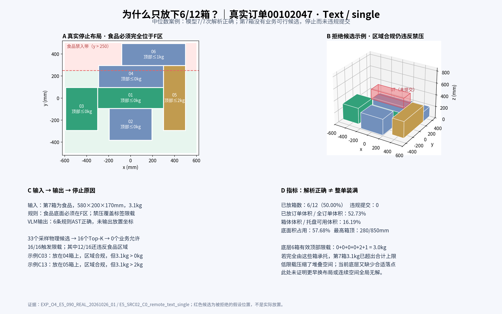

# O4-E5代表性失败订单：可视化与输入输出解析

2026-10-27。结论：这次整单完成率低，不能归因于模型没有理解规则。代表案例中，模型7次编译均正确，但已码6箱的有效顶部限载仅为0、0、0、0、2、1 kg，第7箱重3.1 kg；当前布局的33个采样物理候选中没有一个满足业务约束。程序正确停止，结果是安全但未完成。

## 1. 先看可视化

- [交互页面：逐步布局、原始输入输出和全部拒绝候选](../../../report/visualization/O4E5_00102047_失败案例_20261027/index.html)
- [静态总览PNG](../../../report/visualization/O4E5_00102047_失败案例_20261027/overview.png) · [PDF](../../../report/visualization/O4E5_00102047_失败案例_20261027/overview.pdf)
- [完整失败点输入JSON](../../../report/visualization/O4E5_00102047_失败案例_20261027/last_input.json) · [完整模型输出JSON](../../../report/visualization/O4E5_00102047_失败案例_20261027/last_output.json) · [原始模型输出文本](../../../report/visualization/O4E5_00102047_失败案例_20261027/last_output_raw.txt)



HTML可直接用本地浏览器打开，无网络依赖。滑块展示空托盘、6次真实PLACE和第7次STOP；候选下拉框或候选表可切换16个被拒位置。红色透明箱为假设候选，从未实际提交。输入输出面板随步骤切换，完整冻结订单单独标注为事后信息，不冒充模型当时可见输入。

## 2. 为什么选这个订单

订单来源`00102047`，任务`E5_SRC02_C0`，主案例`E5_SRC02_C0_remote_text_single`。在全部24个Text/single任务中，按已放件数比例排序、以job ID打破同值，取上中位数，得到6/12箱的本案例，避免只展示极端差例。

终止原因`no_compiled_business_candidate`占整轮240个方法记录中的184条（76.67%），是最常见类别。该案例没有C1新增关系，禁接触也没有清洁用品目标配对；适合解释主要的限载与区域冲突，但不能代替所有其他失败类型。

## 3. 实际输入是什么

托盘长1200、宽1000、高度上限850 mm；原点在托盘底面中心，x向右、y向后、z向上；箱体直立，yaw仅0°/90°。single缓冲容量1，只能处理当前到达箱体，不能预看未到达箱体。

失败点请求`O4F_E0013`包含已码6箱、待码`item_07`、公共属性、区域与绑定摘要；Text图片列表为空。模型未被要求直接生成放置坐标，而是将下面6条原始业务规则编译为AST：

```text
规则label：对（全部箱体），累计顶部限载按标签；优先级20；覆盖无。
规则no_top：对（禁压标记等于是），禁止顶部加载；优先级10；覆盖label。
规则reinforced：对（同时满足（货物类别等于玻璃制品，包装加固等于是，禁压标记等于否）），累计顶部限载为2kg；优先级0；覆盖label。
规则contact：禁止（货物类别等于食品）与（货物类别等于清洁用品）直接面接触；优先级20；覆盖无。
规则food_region：对（货物类别等于食品），底面完全位于区域F；优先级20；覆盖无。
规则cleaner_region：对（货物类别等于清洁用品），底面完全位于区域B；优先级20；覆盖无。
```

食品区域F为x∈[-600,600]、y∈[-500,250] mm，占托盘底面75%。整个食品底面必须在F区，仅中心在区域内不足以通过。该规则不会要求普通货物也遵守食品区域。

停止前的真实布局如下，尺寸为放置后尺寸，坐标为底面中心：

| 对象 | 类别 | 已放尺寸mm | (x,y,z) mm | 物理顶部能力kg | 业务有效顶部限载kg |
|---|---|---|---|---:|---:|
| 01 | 食品 | 600×190×160 | (0,0,0) | 60.19 | 0，禁压覆盖标签8 |
| 02 | 普通货物 | 390×290×270 | (0,-240,0) | 36.64 | 0，禁压覆盖标签8 |
| 03 | 食品 | 290×390×270 | (-445,-100,0) | 36.64 | 0，标签本身为0 |
| 04 | 普通货物 | 590×200×280 | (5,195,0) | 52.86 | 0，禁压覆盖标签1 |
| 05 | 加固玻璃 | 200×590×280 | (400,0,0) | 52.86 | 2，强化玻璃例外覆盖标签1 |
| 06 | 普通货物 | 580×200×170 | (210,395,0) | 22.19 | 1，标签限载 |

第7箱是食品，原尺寸580×200×170 mm，重3.1 kg，禁压标记为false、标签限载2 kg。这里要注意：第7箱自身标签2 kg限制的是以后压在它上面的重量，不是它能否放到别的箱体上；它当前给下层带来的重量为3.1 kg。

第8—12箱尚未到达。完整订单在交互页面独立展开，仅供事后分析。

## 4. 模型实际输出与程序实际输出

失败点模型返回`o4_e2_response_v1`响应，包含当前request_id、state_hash、observation_digest、instruction_digest和以下六条AST规则。表中为结构摘要，完整未删减内容见页面及JSON附件。

| rule_id | AST类型 | 选择器 / 参数 | priority / overrides |
|---|---|---|---|
| label | max_top_load | target=all；limit.field=labels.max_top_load_kg | 20 / [] |
| no_top | no_top_load | labels.no_top_load=true | 10 / [label] |
| reinforced | max_top_load | glassware AND reinforced=true AND no_top_load=false；constant_kg=2 | 0 / [label] |
| contact | forbidden_contact | food 与 household_cleaner | 20 / [] |
| food_region | inside_region | food → F | 20 / [] |
| cleaner_region | inside_region | household_cleaner → B | 20 / [] |

模型7/7次首答有效，7/7次最终AST语义一致；本案例没有修复。公共规划器根据该AST筛选候选，最终程序输出：

```json
{
  "event": "STOP",
  "reason": "no_compiled_business_candidate",
  "action": null
}
```

这是程序动作字段摘录，不是模型输出AST本身。真实状态保持6个已码箱，未把第7箱放入任何违规位置。

## 5. 精确到候选的失败原因

最后一步保存的公开采样物理候选33个，Top-K保留16个；完整采样池参考业务允许数0，Top-K允许数也0。16个候选全部触发下层限载，12个还同时越出食品区域。这些原因可交叉出现，不能把16与12相加算成28个候选。

| 可视化候选 | 放置假设 | 物理检查 | 区域 | 业务拒绝原因 |
|---|---|---|---|---|
| C03：`E2_b5277b71fcfe6755` | 底面中心(0,150,280)，yaw0°，压在04上 | 通过 | y范围50—250，在F内 | 04禁压，有效限载0；新增顶部载荷3.1 kg |
| C13：`E2_e6f7e45b6db8d45f` | 底面中心(400,-95,280)，yaw90°，压在05上 | 通过 | y范围-385—195，在F内 | 05有效限载2 kg；新增顶部载荷3.1 kg |
| C01：`E2_e7144486c62c2055` | 底面中心(-90,195,280)，yaw0°，压在04上 | 通过 | y上界295，超F边界45 mm | 同时违反04禁压与食品区域 |

由此可见，换一个不越区的候选仍可能超载。也不能把该步归咎于Top-K删掉了唯一好位置，因为已有33个采样候选的业务允许数本来就是0。

另外，6箱都在底层，当前顶部载荷均为0，有效额度合计为3.0 kg。如果第7箱完全由这些已码箱承托，即便理想地分摊重量，也无法把3.1 kg总重量压到3.0 kg总额度以下。这是当前布局的堆叠障碍说明，不是整个订单全局不可行的证明；地面是否能通过不同早期布局留出合适位置，需要另作规划验证。

## 6. 对应指标

| 指标 | 数值 | 分母/含义 |
|---|---:|---|
| 已放件数 | 6/12，50.00% | 整个计划订单 |
| 已放订单体积比例 | 52.73% | 已放箱体体积 / 12箱总计体积 |
| 托盘体积利用率 | 16.19% | 已放箱体体积 / (1200×1000×850) |
| 地面占用比例 | 57.68% | 已放6箱底面积 / 托盘底面积；六箱均在底层 |
| 已放最高箱顶 | 280/850 mm | 实际高度 / 允许高度 |
| 模型首答有效 / 语义正确 | 7/7 / 7/7 | 本episode的7次编译 |
| 真实API请求 | 7 | 无修复，无额外请求 |
| 采样 / Top-K候选 | 33 / 16 | 当前第7箱决策 |
| 采样 / Top-K业务允许 | 0 / 0 | 当前第7箱决策 |
| 实际业务违规提交 | 0 | 被拒候选未提交 |
| 整单完成 | false | 6已放、1等待、5尚未到达 |

同一来源/C0的Text结果：single为6/12，FIFO为6/12，启发式为5/12，搜索为7/12；整单均未完成。改用搜索可以在本案例多放1箱，但这不是更换模型带来的收益，也不能证明搜索已找到全局最优。

## 7. 为什么整体“效果差”，应该怎样解读

第一，业务限制与物理承载是两套门槛。箱体物理上可承几十kg，合成业务属性和混合规则却把有效限载收紧到0—2kg，而实际箱重3.1—10.65kg，导致几何上有高度也难以堆叠。本轮源订单没有预先保证在这些混合业务规则下全部可解，因此低整单完成率不应直接等同于规划算法的失败率。

第二，single是按到货顺序进行当前状态决策。它没有完整未来订单输入，不重排已经提交的6箱；前期合法放置仍可能让剩余地面变得难以使用。这个案例说明需要分析布局和可用空间，但没有证明某一早期动作错误，也没有独立对照证明换排序必定装完。

第三，这次模型的职责是编译规则，没有承担整单布局优化。AST已经正确，换成Oracle也得到相同方法指标，因此继续重复调用模型不会自动解决低限载与布局限制。

后续若以机器人实用装载率为目标，建议先明确真实业务标签和可堆叠箱的承载范围，区分“任务本身业务不可行”与“方法没有找到布局”，再评估区域感知布局、地面空间预留及缓冲搜索；每项改动建立新的实验版本，不能放宽规则后继续沿用旧分数。

## 8. 产物与验证

本次只读取已保存实验，新增分析目录`report/visualization/O4E5_00102047_失败案例_20261027/`，原始实验与封存代码未修改。

- `build_case.py`：从原始记录导出数据、生成HTML及PNG/PDF；不调用API或规划器。
- `metrics.json`、`last_candidates.json`、`case_data.json`：指标、候选与页面数据。
- `provenance.json`：来源文件SHA256与零新增API/轨迹运行声明。
- `browser_validation.json`：8个步骤、16个候选、输入输出及两种视口的浏览器检查。
- `browser_overview.png`、`browser_input_output.png`：浏览器截图。

页面已检查8个步骤的箱数、16个候选的拒绝原因、失败点输入输出、无提交动作以及1500/760像素视口；无JavaScript异常。静态图已人工查看。此处验证的是可视化，不是额外复查240条实验。
