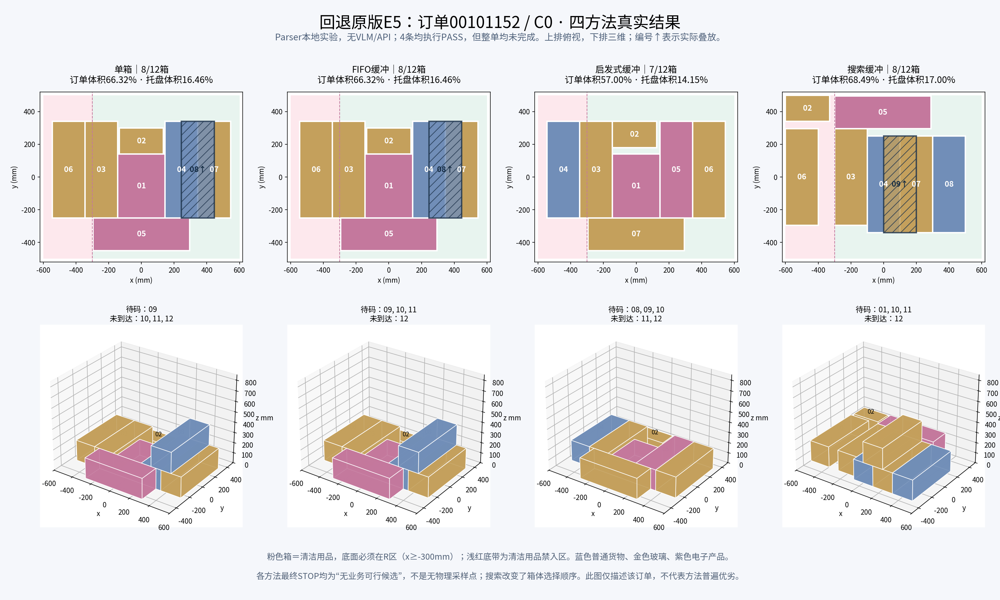

# O4E5回退原版四方法冒烟可视化

本次读取已完成的 `EXP_O4_E5_ROLLBACK_SMOKE_20261027_01`，呈现原版E5在订单00101152、配置C0上的四种方法实际轨迹。没有重新调用API或运行规划实验。

[交互页面：逐步布局、输入输出、失败候选](../../../report/visualization/O4E5_回退原版四方法对比_20261027/index.html) · [原始指标](../../../report/visualization/O4E5_回退原版四方法对比_20261027/metrics.json)

## 实际结果

|方法|已放/计划|订单体积完成比例|托盘体积利用率|实际上层箱|最终待码箱|尚未到达|业务违规步数|
|---|---:|---:|---:|---|---|---|---:|
|单箱|8/12|66.32%|16.46%|08|09|10、11、12|0|
|FIFO缓冲|8/12|66.32%|16.46%|08|09、10、11|12|0|
|启发式缓冲|7/12|57.00%|14.15%|无|08、09、10|11、12|0|
|搜索缓冲|8/12|68.49%|17.00%|09|01、10、11|12|0|

订单体积完成比例＝已放箱体积÷全订单箱体积；托盘体积利用率＝已放箱体积÷托盘1200×1000×850mm体积。前者衡量订单完成量，后者包含未利用高度。

4条episode的执行状态均为PASS，表示执行与记录完成；4条整单均未完成。总计划240条，本次只运行前4条，总验收状态PARTIAL符合这次小实验范围。

## 图中能看到什么

单箱和FIFO的最终布局相同，但最后到货数量不同。两者的08箱底面高度为200mm，叠在上层；搜索则将09箱叠在上层。启发式只放了7箱，全部位于底层。搜索改变了取箱顺序，最终仍待码01箱，因此即使放入箱数相同，放入体积也不同。

粉色箱为清洁用品，必须完全进入R区域，即x≥−300mm；淡红底带只表示清洁用品禁入范围，普通货物可进入。该任务没有食品目标，所以没有将食品区域画成对所有箱体生效的边界。

## 为什么停止

四种方法最终原因均为 `no_compiled_business_candidate`。最后一步仍有物理合法采样候选，但经业务规则过滤后没有可提交动作。

|方法|最后待码对象|采样物理候选数（逐箱）|采样业务允许数|
|---|---|---|---|
|单箱|09|38|0|
|FIFO缓冲|09、10、11|38、38、83|均为0|
|启发式缓冲|08、09、10|55、55、55|均为0|
|搜索缓冲|01、10、11|64、59、125|均为0|

每个待码对象返回Top-K最多16个。单箱、FIFO和启发式最后Top-K的拒绝记录涉及顶部载荷限制；搜索还存在清洁用品超出区域的候选。业务原因可能重叠，不能把原因出现次数相加当成独立候选数。候选池中没有业务可行动作不能证明连续空间全局无解，也不能据此认定订单本身不可完成。

## 交互与数据范围

页面滑块按“已提交放置次数”对齐，初始为空托盘，末端为实际STOP；提前停止的方法保持最终状态。单箱容量1，其他方法容量3，因此相同步数不代表相同到货前缀。页面展示各自到货数、待码箱和放置顺序。

选中方法后可展开本步公共请求、Parser AST与绑定、实际动作和候选JSON。点击最终被拒候选，会画出红色透明假设箱，并明确标记未提交。后验的未到达箱列表用于结果对照，不表示当时规划器可见未来订单。

这是本地 `public_parser` 实验，页面没有VLM回答，也没有原生GOPT策略输出。结论只针对这一开发来源和配置，不支持泛化或四方法普遍优劣的结论。

生成过程保留四条episode的SHA256，并在页面检查时核对原始文件未变；页面检查记录见 [browser_validation.json](../../../report/visualization/O4E5_回退原版四方法对比_20261027/browser_validation.json)。
