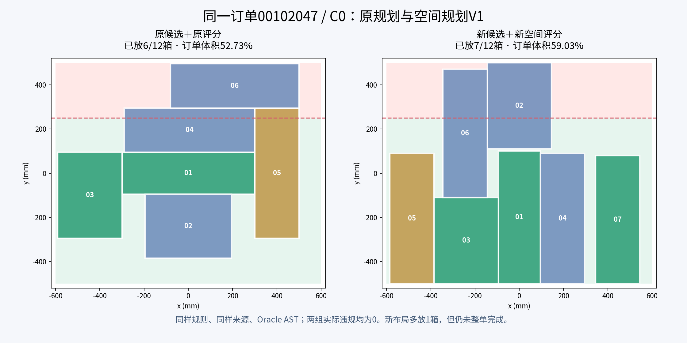

# O4-E5空间规划V1：开发与消融验收

状态更新（2026-10-27）：依用户要求，空间V1已从活动代码、配置和测试中撤回并归档；正式E5入口恢复到空间改进前版本。下文为历史实现/实验分析，不代表当前启用算法；其中空间V1运行命令不再适用于活动工作区。58条历史结果和评分不变。归档位于`semantic_pallet_planner/outputs/ARCHIVE_O4_E5_SPATIAL_V1_ROLLBACK_20261027_01/`。

2026-10-27。候选保留、空间质量评分、缓冲搜索排序及独立离线消融已完成，功能与安全验收通过。**效果为局部改善，尚不建议替换旧默认算法。** 代表订单单箱从6/12提升到7/12，但6个固定单箱任务合计仍为48/72箱，平均订单体积完成比例从66.31%降至65.30%。不将工程PASS写成整体装载效果提升。

依据[实现与验收协议](../../02_阶段实施方案/O4/O4E5空间规划V1实现与验收协议_20261027.md)，本轮真实API调用0；没有额外复查旧240条，也没有覆盖旧真实实验及封存源码。新版本为显式可选，旧默认路径保持原行为。

## 1. 实现内容

新增`o4/extensions/e5/spatial/`：

| 模块 | 实现 |
|---|---|
| config.py | 冻结空间版本、四组开关、10mm网格、固定探针、候选配额与预算 |
| candidates.py | 对同一E2公开物理池保留相邻边缘对齐、托盘边界、区域和朝向代表；去重补齐16个，记录淘汰原因；缓存只依赖公开几何与配置并返回副本 |
| quality.py | 对地面及实际箱顶平面建立保守支撑/占用网格；固定探针覆盖取并集；输出覆盖、未覆盖及对齐指标 |
| planning.py | 保留业务过滤与旧软预算，在预算内按空间质量选择位置；beam及最终路径按件数、体积、高度、空间质量稳定排序 |
| experiment.py | 冻结输入、源码和58个job，支持本地分段续跑，保存完整结果、保护旧输入、单列测量元数据 |

配置为`configs/o4_e5_spatial_v1.json`，独立入口为`runners/o4_e5_spatial.py`。旧`e5/planning.py`只增加存在`o4_e5_spatial`配置时的分派，未配置时仍进入原缓存和E2规划器。与旧真实计划快照逐文件比较34个旧模块，除该分派文件外，其余33个保持相同；旧E2、全局几何评分与物理约束未修改。

位置评分不读取私有参考规则、未到达箱体或完整订单。硬约束先过滤；空间质量只能在旧软预算允许的候选中起作用。所有实际提交继续使用原绑定、业务及独立物理检查。

## 2. 固定决策点：02箱问题已得到对应改进

固定原案例只放入01箱的公共状态，用新建的本地Oracle AST进行同状态比较。此局部检查未把旧模型响应移到不同状态。

| 组合 | 左对齐(-105,-240,0)进入Top-K | 选择的02箱底面中心(x,y,z)与yaw | 与01边缘对齐 |
|---|---|---|---|
| 原候选＋原评分 | 否 | (0,-240,0)，0° | 否，居中 |
| 新候选＋原评分 | 是 | (0,-240,0)，0° | 否，评分仍偏居中 |
| 原候选＋新评分 | 否 | (0,-305,0)，90° | 否 |
| 新候选＋新评分 | 是 | (-155,-290,0)，90° | 是 |

combined选择的旋转后尺寸为290×390mm，左边界-300mm，与01左边界一致；y上界-95mm，与01下边界接触。它并未强行选固定的左侧坐标，而是在合法候选中按空间指标和稳定顺序选出。左右对齐的空间评分镜像一致，测试覆盖这一性质。

## 3. 完整代表订单

来源00102047、C0、single、Oracle下：

| 组合 | 已放箱 | 订单体积完成比例 | 实际违规 |
|---|---:|---:|---:|
| baseline | 6/12 | 52.73% | 0 |
| candidates_only | 6/12 | 52.73% | 0 |
| ranking_only | 6/12 | 52.73% | 0 |
| combined | 7/12 | 59.03% | 0 |

这里完整运行从空托盘开始，新算法也会影响第一箱及后续位置，不能把多放1箱严格归因于第二箱一个动作。固定第二决策点用于验证具体对齐行为，完整episode用于测量后续效果，两种证据分开。

该来源的buffer_search原版与combined均放7/12；Parser的combined单箱和搜索均为7/12，与Oracle对应结果一致。仍未整单完成，不声称解决整个订单的业务可行性。

## 4. 冻结58条新实验及结果

读取已知E5来源任务，按来源键排序取索引0、2、4，各C0/C1共6任务。它们只有3个独立开发来源。6任务×4组×single共24条；来源02的C0/C1再×4组×search共8条；6构造×combined×4规划器共24条；代表来源的Parser单箱/搜索2条，共58条。

四组在同一来源、属性、规则、候选容量和搜索预算下比较，不放宽业务规则，不增加模型权限。代码、任务、配置、job顺序和探针值均在运行前记录于计划。全部58条执行完成，没有失败记录被删除。

单箱6任务，每组分母72箱，整单完成数均为0：

| 组别 | 已放箱/72 | 件数比例 | 平均订单体积完成比例 |
|---|---:|---:|---:|
| baseline | 48 | 66.67% | 66.31% |
| candidates_only | 48 | 66.67% | 66.31% |
| ranking_only | 46 | 63.89% | 63.20% |
| combined | 48 | 66.67% | 65.30% |

combined与baseline逐任务对比如下：

| 来源任务 | 原版 | combined | 件数变化 |
|---|---:|---:|---:|
| SRC00/C0 | 8 | 7 | -1 |
| SRC00/C1 | 8 | 7 | -1 |
| SRC02/C0 | 6 | 7 | +1 |
| SRC02/C1 | 6 | 7 | +1 |
| SRC04/C0 | 10 | 10 | 0 |
| SRC04/C1 | 10 | 10 | 0 |

来源02的两个search任务，每组分母24箱：baseline为14箱、candidates_only为12箱、ranking_only及combined均为14箱。新候选配额单独使用也可能削弱搜索，因此不能只看对齐候选是否保留。

## 5. 工程验收

| 检查 | 实际证据 |
|---|---|
| 新旧回归测试 | 104项通过，427.25秒；含24项新测试及80项既有E5测试 |
| 真实闭环安全 | 58条新记录，物理提交沿用独立检查；业务违规步数0、提交错误0 |
| 候选/搜索资源 | 实际最大每对象16、联合48、深度3、beam8、后继256 |
| 正构造 | 4个正构造×4方法，共16条全部完成 |
| 业务无解构造 | 2个反例×4方法，共8条全部正确停止、无违规 |
| 恢复和确定性 | 四方法构造恢复一致；重复选择不改变实际状态；既有恢复/绑定测试继续通过 |
| 绑定与旧版本 | 陈旧候选摘要拒绝；默认E5路径与原选择/缓存行为一致 |
| 源码/输入绑定 | 新实验运行前后源码摘要一致；被引用旧任务、配置及验收/封存元数据摘要不变 |
| 模型请求 | 0；无remote入口，旧945次真实请求结果不改写 |

验收PASS的范围是新功能、安全边界和本地测量完成。默认替换建议为`NOT_RECOMMENDED`，不是整体收益PASS。

## 6. 覆盖与成本

候选仍有16个名额。本次保存的406个新候选分组中，区域和朝向代表相对旧Top-K均未丢失。方向/0、50、100mm间距组的详细覆盖见`coverage.json`：264个分组未覆盖完整物理采样池的全部方向/间距组。此处比较的是完整采样池与保留候选，不能写成“264个分组相对旧Top-K退步”；也不能声称所有原方向覆盖不变。

墙钟记录中，6个single任务baseline合计52.32秒、combined合计56.58秒；两个search任务分别79.88秒、95.97秒。计时包含episode的编译、规划和独立诊断，不是纯评分耗时；执行期间与回归测试并行且存在缓存，不作为公平速度基准。

## 7. 限制与交付判断

固定探针只是几何代理：10mm网格保守处理障碍和支撑，上层跨箱接缝可能低估；探针只定义底面，不验证重量、业务类别或箱高。未被探针覆盖的窄条不一定无用，覆盖到的面积也不一定能放实际后续箱体。不得把这一评分当作硬拒绝或全局无解证明。

本次combined的平均最终地面探针覆盖比例从原版14.61%增加到15.51%，但真实订单体积完成比例反而下降，说明代理指标改善不自动带来实际装载改善。新增功能已实现，代表问题已验证，当前总体效果不足以默认替换原算法；没有根据这批结果继续调参后宣称独立测试成功。

这批只有3个已知来源，不构成未见泛化或模型收益证据。旧E5真实入口仍使用冻结旧规划，新版本只通过显式配置/本地入口启用。若后续继续改进，应以真实装入指标和业务可用空间为目标另立版本及验证集，而不是追求布局图更整齐。

## 8. 交付入口

[运行手册](../../04_运行与复核手册/O4E5空间规划V1运行手册_20261027.md)记录实际CLI、分段与续跑。开发者已完成本轮实验，无需用户重复运行。

- 新结果：`semantic_pallet_planner/outputs/EXP_O4_E5_SPATIAL_LOCAL_20261027_01`，含封存源码、输入、58条完整episode和指标。
- 交付证据：`report/analysis/O4_E5_SPATIAL_DEVELOPMENT_20261027_01/acceptance_audit.json`、`delivery.json`。
- 测试：同目录`tests.xml`。
- 固定决策点与覆盖：`local_decision.json`、`coverage.json`。
- 逐任务配对与边界：`paired.json`、`bounds_and_constructs.json`。
- 旧模块保护：`legacy_source_protection.json`。
- 图表：`representative_before_after.png`及生成脚本`plot_case.py`。

原E5离线额外全量复算豁免继续保留，本轮不重新标记为通过。
