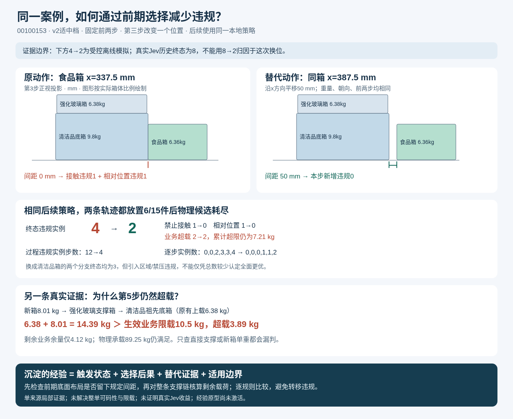

# 同案例降低违规：可视化案例

> 业务语义已纠正：下方50 mm平移案例只适用于旧面接触协议，其业务改进结论已撤回。用户明确食品与清洁品不可同托盘放置，间距不能消除该冲突。最新实际分叉实验见[同箱候选排名对照](同箱候选排名对照.html)与[实验报告](../../Jev_J4同箱候选排名分叉对照_20261101.md)：固定同箱，按保存概率切换放置候选；本次未发现全面更优替代。

用浏览器打开[案例交互对照](案例交互对照.html)，拖动第1～6次放置滑块，切换正视/俯视投影，观察同一案例的两条受控轨迹。页面自包含，不需要服务器或外部依赖。

## 如何降低违规

固定前两步，第3步把同一个食品箱的x坐标从337.5改为387.5 mm，保留至少50 mm的食品/清洁品边缘间距。同一本地后续策略下，两边均放置6/15件，终态违规实例4→2，过程违规实例步数12→4。消除的是接触和相对位置违规；限载仍有2个实例，累计超限仍为7.21 kg。

## 具体沉淀的经验

1. **空间状态案例**：物理可行不保证满足业务间距。当食品与清洁品边缘相接时，先检查同箱其他物理候选位置。本例平移50 mm满足不接触与间距要求，受控后续轨迹也减少违规。这一结论绑定本例状态、候选和后续策略，不泛化为所有食品箱固定右移50 mm。
2. **支撑链失败机制**：要核算每个受影响祖先支撑箱的生效业务剩余承载余量，不能只看直接支撑或新箱单重。真实第5步底箱已有6.38 kg上载，限载10.5 kg，只剩4.12 kg，却又传入8.01 kg，因此超载3.89 kg。当前未找到解决此载荷问题的全面更优分支。
3. **候选比较原则**：同放置量下逐规则、逐单位比较，并检查过程暴露。两个换清洁品箱方案虽然终态实例4→3，但出现区域/禁压违规，不能只按实例总数判为全面更优。

来源为一个训练来源的真实历史和已保存的离线模拟。真实Jev历史终态8个实例与这里本地对照4个实例的后续策略不同，不能把8→2归因于一次换位。两分支均物理早停，未证明完成整单或真实Jev收益；经验仍为原型，尚未激活。

## 文件与复核

- [交互页面](案例交互对照.html)：逐步布局、违规曲线、规则明细、支撑链和经验解释。
- [矢量总览](案例改进总览.svg) / [PNG总览](案例改进总览.png)：适合插入报告或分享。
- [证据绑定](evidence_binding.json)：源JSON摘要；构建不回放轨迹，不调用模型。
- [浏览器检查结果](visualization_checks.json)：12种步骤/投影组合、播放/暂停、390px窄屏无横向溢出、无JavaScript异常。
- `template.html`和`build.py`：HTML/SVG构建源；在仓库根目录执行 `python docs/03_阶段产出分析/O4/visualizations/Jev_J4状态动作案例_20261101/build.py` 可重新生成页面与SVG。PNG为Chrome导出的SVG图像。

本次只新增可视化，没有新增Jev/DeepSeek请求或离线模拟，没有修改封存案例。
