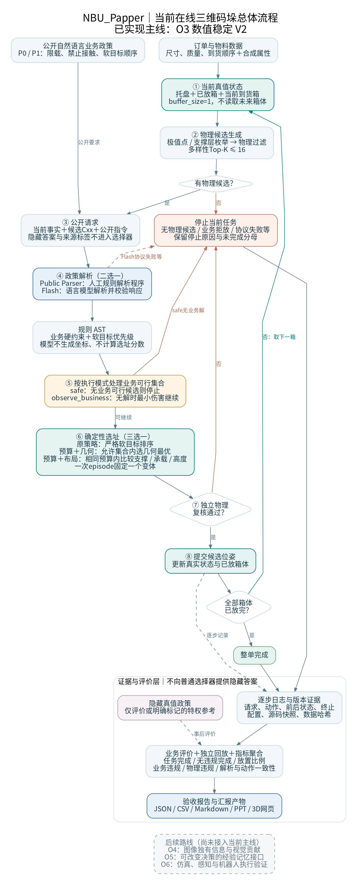
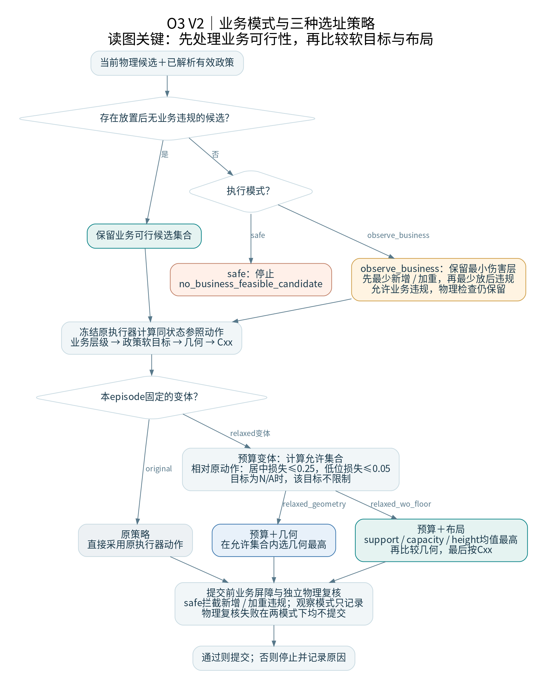

# NBU_Papper总体逻辑框架与论文题目建议

日期：2026-10-21。依据当前O3数值稳定V2运行器、执行器和已完成实验；不把O4/O5/O6计划表述为已实现。

## 一、总体流程图

可下载：[SVG矢量图](总体流程图.svg)、[PNG图片](总体流程图.png)、[Mermaid源码](总体流程图.mmd)、[Graphviz源码](总体流程图.dot)。

当前任务是：**让程序在物理候选上执行公开语言业务要求，逐箱更新真实布局，并验证整单完成和业务合规。**

核心链路：订单与当前状态 → 物理候选 → 公开政策解析 → 确定性选址 → 检查与提交 → 下一箱 → 事后评价与回放。

| 层次 | 回答什么问题 | 当前实现 |
|---|---|---|
| 数据与状态 | 当前托盘上有什么、现在能处理哪一箱 | DatasetRepository、不可变状态快照、buffer1 |
| 几何层 | 当前箱有哪些位置符合物理条件 | 极值点/支撑层枚举、硬约束过滤、多样性Top-K≤16 |
| 政策解析层 | 自然语言到底要求什么 | Public Parser或Flash输出受限政策AST |
| 确定性决策层 | 候选中应选哪个 | 原策略、预算＋几何、预算＋布局三变体 |
| 执行层 | 此动作是否提交，提交后状态是什么 | 按业务模式处理，独立物理复核，提交保存位姿 |
| 评价与证据层 | 整单是否完成、是否合规、能否复现 | 隐藏真值评价、逐步日志、回放、聚合与验收 |

### 1. Flash位于哪里

Flash与Public Parser是同一位置上的两种替代解析来源，一次运行选其中一种。Flash将公开指令转换成AST，不计算承载、不产生坐标、不直接选择布局。其有效政策进入相同执行器。

当前P0/P1真实矩阵的1502次调用中，Flash与Parser的有效政策、动作与闭环状态一致；原始AST结构并非全部相同。因此当前布局提升属于执行器/策略证据，尚非模型增量证据。

### 2. 三种策略位于哪里

一次episode固定一个策略，图中的三种策略不是先后串联，也不是投票。

- 原策略：满足业务硬规则后，按政策软目标优先级严格排序，再按几何评分与Cxx破同分。
- 预算＋几何：以同一状态下原执行器动作作参照，在明确软目标允许损失范围内选几何最优。预算不是费用、时间或允许物理违规。
- 预算＋布局：使用相同预算集合，按支撑、承载、高度三项布局代理评分，再比较几何并按Cxx破同分。

预算按归一化软质量定义：heavy_center为0.25、heavy_low为0.05；不等于固定毫米距离。重箱目标为N/A时不施加对应预算限制。排序采用冻结的V2稳定协议，不改变物理、业务EPS或原控制。

### 3. 停止与循环

无物理候选时停止。安全模式无业务可行候选时也停止。观察模式允许在业务无解时按最小伤害继续，但不放松物理检查。Flash协议失败等异常保留失败原因，不应冒充有效选择。

每次提交后从真实新状态生成下一箱候选，直到全部放完或提前终止。完整订单运行不是重复在同一份固定候选表上选答案。

评价层保留未完成任务，不以“零违规”代替“完整无违规成功”。隐藏真值仅进入评价或明确标记的特权参考，不进入普通方法的政策解析或选址。

## 二、业务处理与三种策略的详细分支

[SVG矢量图](业务选址分支.svg)。图中观察模式允许业务违规，但物理复核在两模式都生效。原执行器本身也有业务无解时的最小伤害排序，预算变体在冻结层级内计算其允许集合。

## 三、目前已完成与预期研究的关系

- **已完成：** 真值状态的严格在线闭环、语言到AST、共同执行器、布局预算与消融、稳定数值排序、真实Flash调用、回放验收。
- **已见信号：** 10个已见来源、20个政策任务上，预算布局无违规完成从7/20提升至12/20；存在SCN_0054/P1从11箱到17箱的清晰改善案例。
- **仍有局限：** SCN_0060等订单未解决；同预算几何控制与布局策略各有取舍；方法经过开发集消融筛选，需独立来源检验。
- **尚待证明：** 模型相对强Parser的语言泛化收益；视觉独有信息贡献；可验证经验更新的决策收益；机器人执行。

## 四、三个论文题目

下面是三个不同研究重心的候选题目，不是已经完成的三篇论文。推荐依据证据匹配程度选择主线。

### 题目1（当前最推荐）

**面向自然语言业务约束的在线三维码垛规划与布局保留方法研究**

研究问题：如何把语言政策转成可执行约束，同时缓解逐步业务偏好对整单布局造成的损害。

拟形成的方法贡献：受限AST与确定性执行解耦、显式软目标预算、支撑/承载/高度布局代理，以及统一的完整订单评价。

已有支撑：O2b/O3共同执行器、O3失败归因、三策略消融、V2真实配对、SCN_0054改善与SCN_0060负例。

必须补齐：独立来源验证，预算与特征消融及预先定义的稳健性检查；同时报告整单无违规完成、完成率、放置比例和业务损害。当前支持开发证据，不能直接声称独立泛化或显著模型优势。

适用判断：最贴合当前真实工作，题目不预设Flash一定优于Parser；模型即使持平，仍能如实讨论架构与布局方法的适用边界。

### 题目2（突出语言模型协同）

**面向动态业务规则的语言模型与几何协同在线三维码垛方法研究**

研究问题：面对未见表达、真实条件分支和业务政策变化，语言模型是否比冻结的强规则Parser更可靠地生成可执行政策，并改善下游任务。

拟形成的方法贡献：可校验政策接口、语言与几何职责分离、政策变化下的安全执行与归因评价。真实动态政策能力属于预期，需要新增实验。

已有支撑：公开请求白名单、Flash AST协议、状态和政策绑定、完整订单执行器、真实调用记录。

必须补齐：按来源与语言模板族隔离；冻结强Parser后测试未见表达、对象绑定、不同双分支条件和在线政策变化；分开评价AST、执行语义、选址及整单表现。现有相同双分支条件包装不能作为条件推理证据。

适用判断：更贴合模型主线，但当前模型与Parser持平，尚不足以把模型增量写成已经证实的贡献。当前采用“语言模型”更准确，不宜仅因3D可视化存在就使用“视觉语言模型”。

### 题目3（面向后续经验演化）

**面向规则变化的语言—几何协同码垛与可验证经验演化方法研究**

研究问题：能否从已验证的失败与成功轨迹提炼经验，在规则变化后确认、修订或失效处理，并实际改变选址、提升后续任务表现。

拟形成的方法贡献：与候选选择相连接的经验接口、检索与更新机制、基于回放的经验验证及政策变化后的失效机制。

已有支撑：逐步可追溯轨迹、确定性回放、失败归因、Stationary/Policy-Shift任务流数据；这些只是构建记忆方法的基础。

必须补齐：实现O5，先说明经验影响解析、排序还是策略参数；比较NoMemory、冻结检索、动态经验与验证/修订消融；隔离未来反馈与测试污染，不能只给Prompt添加经验后就声称改变决策。

适用判断：与原课题长期目标接近，适合作为后续扩展方向；当前尚未实现动态经验，不建议立即作为已经完成的论文贡献标题。若再加入视觉，则还必须单独完成O4信息缺口与公平对照。

## 五、选择建议

如果近期需要确定可落地的论文题目，优先题目1；如果后续实验重点转向未见语言和政策变化，选择题目2；题目3适合明确投入经验演化开发后的长期方向。三者都不应在题目或摘要中预先承诺“最优”“显著优于”或机器人执行成功。

目前建议对外概括为：**已经完成可复现的语言规则—几何执行在线闭环，正在检验长期布局收益及其泛化；模型和经验的独立贡献仍需专门实验。**

## 六、关键代码与证据

- [最新V2运行器](../../semantic_pallet_planner/src/semantic_pallet_planner/runners/layout_flash_validation_v2.py)
- [原政策执行器](../../semantic_pallet_planner/src/semantic_pallet_planner/selectors/policy_executor_v2.py)
- [稳定布局选择器](../../semantic_pallet_planner/src/semantic_pallet_planner/selectors/layout_preserving_v2.py)
- [公开请求与业务屏障](../../semantic_pallet_planner/src/semantic_pallet_planner/runners/o3_online_adapter.py)
- [最新真实矩阵验收](../../semantic_pallet_planner/outputs/EXP_OPT_O3_LAYOUT_FLASH_V2_VALIDATION_20261020_01/acceptance_report.json)
- [现有逐步3D案例](../visualization/O3_SCN0054_P1_逐步进展与卡点_20261021/index.html)

本次只新增本目录的图与说明，没有更改算法或重跑实验。
