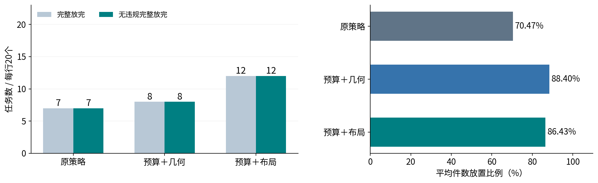
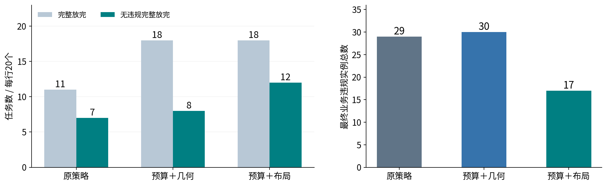
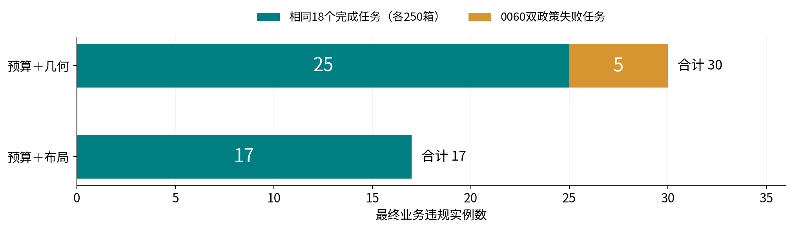
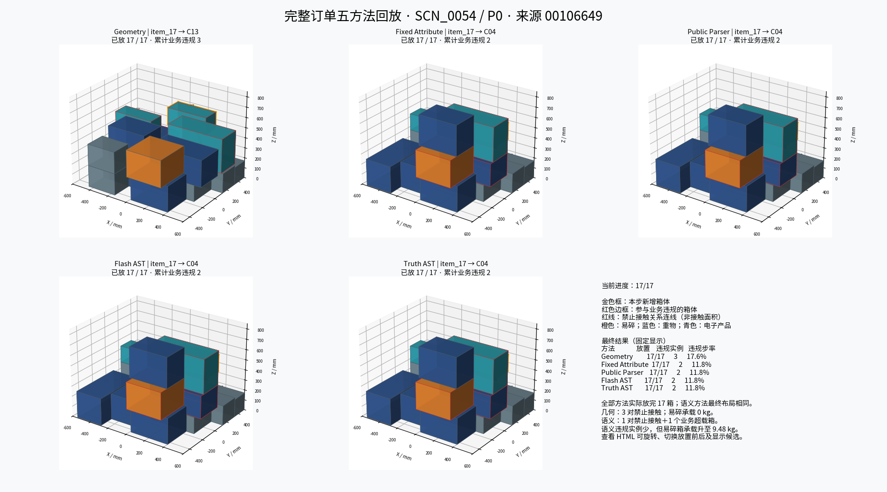
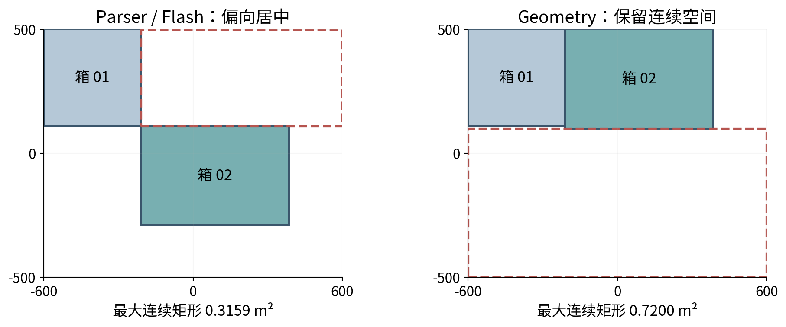
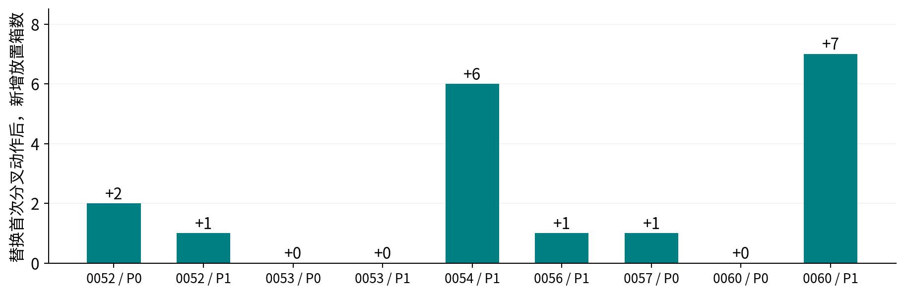
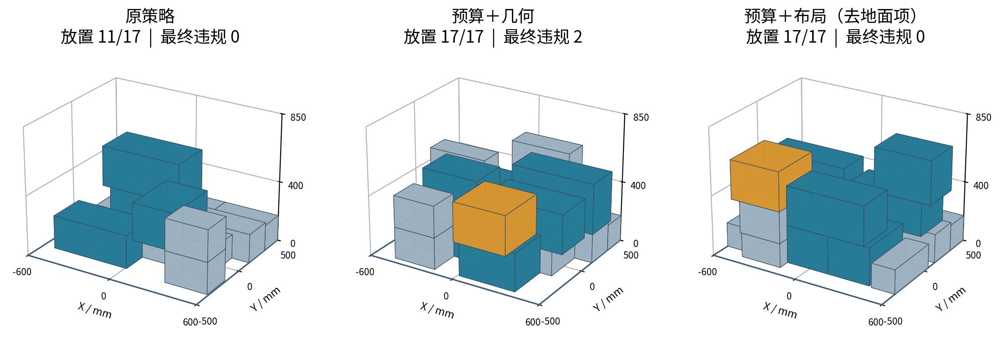
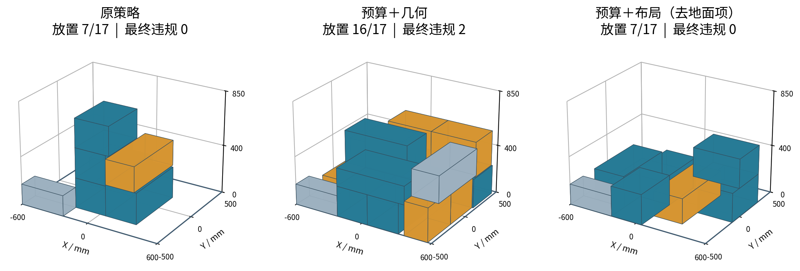
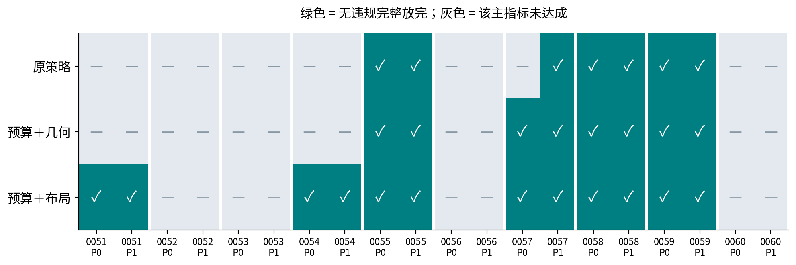

# NBU_Papper 项目进展与卡点报告

汇报日期：2026-10-21。面向组会或阶段汇报；建议主讲20—30分钟，最后一页为指标附录。

本报告依据仓库源码、已有原始实验、验收文件与逐步轨迹编写。此次不运行新实验，不调用API，不改动算法与历史产物；图表为既有实验数据重绘，案例来自实际保存位姿。最新状态已更新为：**数值稳定V2真实完整配对240个episode工程验收PASS**。

- [下载PPTX](NBU_Papper项目进展与卡点汇报_20261021.pptx)
- [24页PPT总览](PPT预览.png)
- [来源摘要与校验记录](evidence.json)

## 1. 面向汇报的核心结论

项目已经从固定候选的单步语义选择，推进到完整订单的属性感知在线闭环。数据、几何候选、语言政策解析、确定性执行、独立物理检查、业务评价和日志回放已具备工程证据。

当前主要工作已转为：解释局部政策排序为何导致长期布局失败，并在明确的软目标预算内改进整单表现。V2去地面项布局策略在已见开发数据上把无违规整单完成从7/20提高到12/20；但相对同预算几何控制仍有放置比例取舍，SCN_0060等失败尚未解决。

模型的独有贡献尚未出现。最新1502条比较记录中，Flash与Public Parser的当前有效政策、同状态动作和闭环状态完全一致。当前结果支持受限政策解析接口可靠，不能支持Flash优于强Parser、视觉贡献或动态记忆贡献。原始AST结构并非全同：完整配对中有52个冗余条件AST，其双分支均相同，约简后与Parser语义一致；不能将其解释为真实条件推理。

## 2. 工程框架与数据交互

```text
BED-BPP订单＋合成属性
  → DatasetRepository只读加载与Schema/引用校验
  → 当前状态（托盘、已放箱、当前箱；buffer_size=1）
  → 极值点/支撑层枚举与物理过滤 → 多样性Top-K≤16
  → 公开请求（自然语言、当前事实、候选Cxx；不含隐藏答案）
  → Public Parser / Flash → 受限政策AST
  → 共同Executor / V2布局选择器
  → 业务模式检查＋独立物理检查 → 提交候选位姿
  → 新真实状态 → 下一箱
  → JSONL轨迹、CSV指标、manifest、独立回放和验收
```

| 代码位置 | 职责 |
|---|---|
| `repository.py`、`domain.py`、`config.py` | 只读数据与配置、不可变快照、状态恢复 |
| `planner/generator.py`、`constraints.py`、`scoring.py` | 候选枚举、硬约束与几何评分 |
| `selectors/instruction_parser_o1b.py` | 公开自然语言政策解析 |
| `selectors/policy_executor_v2.py` | 冻结的原政策数值执行器 |
| `selectors/layout_preserving_v2.py` | 相同预算允许集合上的稳定布局排序 |
| `vlm/policy_protocol_o2b.py`、`layout_flash_client.py` | AST协议、绑定校验、真实调用、最多一次格式修复 |
| `runners/attribute_o3_online.py` | 历史O3五方法在线矩阵 |
| `runners/layout_flash_validation_v2.py` | 最新三变体双解析来源矩阵与回放验收 |
| `evaluation/` | 独立物理检查、传播载荷、业务评价、布局代理和回放 |
| `logging/`、`visualization/` | 原始证据持久化与3D展示 |

早期1A—1C主要通过`cli.py`和`PalletEnvironment`运行，当前O3有独立模块入口；不能只读通用CLI推断最新执行逻辑。第三方GOPT、ReMe、PackLab目录属于参考资源，不代表完整算法已集成。

物理层限制0°/90°水平旋转，检查边界、总载荷、碰撞、支撑率（至少0.70）、重心投影、不可堆叠与递归承重。几何评分权重为紧凑0.35、高度0.25、稳定0.25、平衡0.15。独立物理复核不调用候选生成器。

Flash只返回AST，需绑定`request_id`、`state_hash`、`policy_digest`；不生成坐标，不读取未来箱体。当前`heavy_center`是各重箱中心距的质量加权平均，不能误称整垛质心偏移。

## 3. 数据与阶段进度

数据集包含100个基础场景（train50、validation10、test-ID20、Geometry-OOD10、Semantic-OOD10）、20个Language-OOD配对场景和20个buffer3配对场景，共140个场景文件；另有360个固定决策题、360组固定候选、360份Oracle、100份参考方案以及8条连续流。

尺寸、质量和到货顺序来自BED-BPP；材质、易碎性、可堆叠性、品类与承载上限包含固定种子合成值。合成承载上限与政策的业务限载是两种约束。buffer3和任务流已存在，但当前主线仍是buffer1，尚无动态经验记忆。

| 阶段 | 已完成 | 当前边界 |
|---|---|---|
| 0 / 1A—1B | 数据、接口、几何候选、在线基线、回放和可视化 | 非完整GOPT学习型基线 |
| 1C | 360题×6方法，2160条历史固定题记录；Text/Visual | 旧test已查看，视觉增量很小 |
| O1b / O2a | 语言政策题、AST、绑定校验与协议修复 | 历史人工签认等仍按原记录待完成 |
| O2b | 180题×6方法，1080条记录回放通过 | 统计设计待补；未证实模型超过强Parser |
| O3在线 | 安全和业务观察模式真实五方法工程PASS | 单步局部目标导致整单布局问题 |
| O3失败归因 | 9失败任务、首分叉、终止漏斗、单动作干预 | 不是连续空间全局无解证明 |
| O3布局 | 9变体×双政策×双模式，共360离线episode | 已见开发来源，较好变体经消融筛选 |
| O3数值V2 | 双Python认证、真实冒烟及240真实配对PASS | 仍无独立新test和模型增量证据 |
| O4 / O5 / O6 | 视觉 / 经验记忆 / 机器人研究路线 | 尚未形成对应完整实测闭环 |

## 4. 最新真实实验与结果

矩阵：**10个来源订单×2政策×3变体×2模式×2解析来源＝240 episode**。每行20个政策任务来自10个来源，不能把240 episode、1502调用或3042事件当成独立样本量。

P0：易碎业务限载1kg，重箱低位优先、居中次之。P1：限载3kg，居中优先、低位次之。两者包含相应禁止接触规则。`safe`在无业务可行候选时停止；`observe_business`允许提交业务违规并在无解时按最小伤害等排序。两模式均维持物理检查。

三变体：`original`保持原字典序执行器；`relaxed_geometry`在显式预算内选几何最高；`relaxed_wo_floor`使用相同预算，增加support/capacity/height三项均值布局评分。预算为heavy_low=0.05、heavy_center=0.25。相对原策略的变化包含目标放松，不能全部归因于布局评分。

| 工程项 | 最新结果 |
|---|---|
| 完整配对 | 240/240 episode，工程PASS |
| 回放 | 3042条事件PASS；对照稳定基线1521条 |
| 真实调用 | 1502次；首答合法1502/1502 |
| 修复 / 失败 / 传输重试 | 0 / 0 / 0 |
| 物理违规 / 输入泄漏 / 预算越界 | 0 / 0 / 0 |
| 当前有效政策 / 同状态动作 / 闭环状态一致 | 各1502/1502；不等于原始AST结构全同 |

Parser与Flash各组指标完全相同，下表合并列示；不能把相同结果计为额外独立证据。

| 模式 | 变体 | 完整放完 | 无违规完成 | 平均件数比例 | 违规步 / 提交步 | 最终违规实例 |
|---|---|---:|---:|---:|---:|---:|
| safe | original | 7/20 | 7/20 | 70.47% | 0/200 | 0 |
| safe | relaxed_geometry | 8/20 | 8/20 | 88.40% | 0/250 | 0 |
| safe | relaxed_wo_floor | 12/20 | 12/20 | 86.43% | 0/241 | 0 |
| observe_business | original | 11/20 | 7/20 | 85.21% | 26/238 | 29 |
| observe_business | relaxed_geometry | 18/20 | 8/20 | 99.41% | 29/282 | 30 |
| observe_business | relaxed_wo_floor | 18/20 | 12/20 | 94.12% | 21/264 | 17 |





解读：预算布局相对原策略无违规完成提升25个百分点，相对同预算几何控制提升20个百分点。观察模式最终违规17对30，但平均件数94.12%低于几何99.41%，不能称全面占优。聚类bootstrap属于探索性开发统计，未作多重比较修正。

同预算无违规完成率差为+20个百分点，探索性95%来源聚类区间为[0,50]个百分点，不能据此宣称稳健显著优势。

### 4.1 违规减少是否仅仅因为少放箱子

两个改进方案完成完全相同的18个观察模式任务，这批任务均提交250箱。按同一完成任务集合独立拆分：

| 相同任务集合 | 预算＋几何 | 预算＋布局 |
|---|---:|---:|
| 完成任务数 / 提交件数 | 18 / 250 | 18 / 250 |
| 这些完成任务最终违规实例 | 25 | 17 |
| 这些完成任务违规步骤 | 25 | 21 |
| 失败0060双政策提交件数 | 32 | 14 |
| 失败0060双政策最终违规实例 | 5 | 0 |

总违规实例减少13个，其中8个来自相同完成订单上的改善，5个来自失败订单的不同放置暴露。因此收益不全由少放箱造成，但整体违规率仍受放置数量影响。这是描述性解释，没有新增子集显著性检验。



## 5. 重点案例及建议讲解顺序

### 5.1 历史五方法完整订单：完成不代表合规

SCN_0054/P0历史五方法均放完17箱；Geometry最终3个业务违规实例，其余方法2个，Parser/Flash/真值AST布局相同。此图用于建立“业务违规仍需单独检查”的直观认识，不能与最新V2布局效果混用。



### 5.2 SCN_0052/P0：首次分叉如何切碎空间

历史原策略第2箱与Geometry分叉。两个备选动作当时均无业务硬违规，净空总面积同为0.8099m²，但Parser最大连续矩形0.3159m²、Geometry为0.7200m²。Parser最终停止于6/8箱。形状适配比总空地面积更有解释力。红虚线是诊断报告给出的最大地面连续矩形；视图来自历史保存位姿。



### 5.3 SCN_0054/P1：支撑与堆高的反例

历史原策略第6箱分叉，首次分叉后保留更多地面净空，却更早堆高。第12箱到货前，Parser/Geometry垛高670/420mm；最大同高可堆叠连通面119900/226200mm²。70个无碰撞位姿全部因支撑不足被拒。不能仅靠地面空地面积解释失败。

9次单动作替换后，6个任务多放箱，4个完整完成，其中2个无违规完成；3个放置数量不变。这是离线机制干预，不是新策略成绩。



### 5.4 最新V2改善案例：SCN_0054/P1

| 模式 | 原策略 | 预算＋几何 | 预算＋布局 |
|---|---|---|---|
| safe | 11/17，最终0违规 | 15/17，最终0违规 | 17/17，最终0违规 |
| observe_business | 11/17，最终0违规 | 17/17，最终2违规 | 17/17，最终0违规 |

该案例展示从“未完成且零违规”到“完成且零违规”的提升。下图直接重绘最新真实矩阵的Parser轨迹；Flash指标和状态一致。橙色为易碎箱，青色为非易碎重箱，灰色为其他箱体；颜色不表示违规。



### 5.5 最新V2残留失败：SCN_0060/P1

观察模式下，原策略7/17且最终0违规；预算几何16/17且最终2违规；预算布局7/17且最终0违规，均以无物理候选终止。P0同样是几何16/17、布局7/17，几何最终3违规。当前布局代理还不能充分表示长宽适配和长期可放性，零违规不能抵消未完成。



### 5.6 收益集中性与统计边界

预算布局较原策略新增5个无违规完成任务：0051/P0、0051/P1、0054/P0、0054/P1、0057/P0，实际来自3个来源订单，原有成功任务未丢失。去地面项来自既有消融筛选，必须在独立来源复核。

相对同预算几何控制，新增的4个无违规完成任务集中在0051、0054两个来源，不能把政策任务数作为独立样本数。



## 6. 数值复现问题与版本边界

V1真实冒烟72 episode、508调用工程PASS；V1完整配对240 episode、1495调用，因5条历史布局轨迹不一致保留FAIL。同一特征均值在Python3.11与3.13分别为0.4207292622421585和0.42072926224215856，微小数值差异改变近同分动作，进而造成整单分叉。

V2使用`math.fsum`和集合最大值锚定的1e-12近同分层，之后比较几何评分并按Cxx选择。排序协议为`layout_preserving_v2_fsum_max_anchor_1e-12`。它没有修改物理判定、业务EPS、原控制或软预算。

两环境各自从空托盘运行120个逻辑任务，1521条事件动作与状态交叉一致；这是同一矩阵的双环境复现，不是240个独立研究样本。最新V2真实冒烟72 episode、508调用已PASS，完整矩阵240 episode、1502调用也已PASS。

V2观察模式去地面项最终违规实例为17，不得引用旧布局15或V1 C的16来描述V2。V1的FAIL继续保留。

## 7. 当前卡点与后续建议

| 优先级 | 卡点 | 建议交付与判定重点 |
|---|---|---|
| P1 | 长期布局代理与目标取舍 | 独立来源比较三变体；0060终止漏斗；完整无违规、完成率、件数比例一起报告 |
| P1 | 泛化与统计 | 冻结来源、模板族、主终点、重复次数与聚类统计；旧已查看test仅作回归 |
| P2 | 模型相对强Parser的增量 | Parser充分开发后冻结；新语言、条件与政策组合；分别报告AST、执行语义、动作和整单效果 |
| P3 | 视觉贡献 | 先定义图像独有信息；比较部分信息Text、Visual、OCR＋同Executor与完整真值Text |
| P3 | 动态经验 | 先定义经验如何改变排序或策略；再比较NoMemory、冻结检索和动态记忆，隔离未来反馈 |
| 后续 | 机器人迁移 | 确定性几何通过后再验证仿真、可达性、感知与执行；目前不作机器人成功声明 |

历史O1b/O2a人工签认、维护工时及O2b完整统计设计仍按原报告保留未结，不将Agent核查改写成人工签认，也不增设其为本轮O3工程门槛。当前数值卡点已解决，不应再次列为待修复；正式新test、视觉与记忆尚未完成。

## 8. 24页PPT配套讲解稿

以下逐页给出建议讲解重点与证据位置。PPT中也嵌入了相同讲者备注。

### 第01页：语义三维码垛：项目进展与关键卡点

NBU_Papper｜阶段0 → O3数值稳定V2｜2026年10月21日

**讲解：** 本次汇报围绕三件事：工程目前做到哪里，现有实验能支持什么结论，以及下一步应优先解决什么。最新V2真实完整配对已通过工程验收，不能继续沿用早前“运行中”的状态。所有图表来自已有实验和日志，不新增模型调用。

**来源：** 最新证据：EXP_OPT_O3_LAYOUT_FLASH_V2_VALIDATION_20261020_01 / acceptance_report.json

### 第02页：当前进度可以归纳为三句话

区分工程完成、实验观察与论文证据

**讲解：** 第一，数据、候选、语言解析、执行、回放已闭环。第二，局部业务目标会导致后续布局失败，布局策略已改善整单表现。第三，Flash与强公开Parser完全一致，当前还不能声称模型贡献、视觉贡献或经验记忆贡献。

**来源：** 来源：O3真实验收、失败归因、V2完整配对指标

### 第03页：工程已推进到 O3 布局验证阶段

旧阶段1D≈在线闭环；旧1E≈经验记忆，协议与验收仍需分别理解

**讲解：** 早期先建设数据与几何平台，1C加入固定题文本和视觉模型。O1b至O2b逐步转向政策AST与共同执行器。O3完成完整订单闭环后，工作重点已转为失败归因、布局取舍和可复现性。O4与O5属于后续路线。

**来源：** 来源：docs/README.md；阶段0、1A—1C、O2b、O3对应验收报告

### 第04页：当前架构：语言解析与数值选址分工明确

Flash负责受限AST；几何安全、载荷与排序由确定性程序负责

**讲解：** 模型输入是公开请求，不含隐藏真值。Parser和Flash生成的AST进入相同执行器，因此两者差异才可归因于解析来源。状态由程序提交候选后更新，隐藏政策用于事后评价，不进入普通方法的选址。

**来源：** 源码：runners/layout_flash_validation_v2.py；o3_online_adapter.py；selectors/policy_executor_v2.py

### 第05页：数据已经齐备，真实性与可见性必须分开

140个场景文件 = 100基础＋20语言配对＋20缓存配对

**讲解：** BED-BPP提供尺寸、质量和顺序。材质、易碎、可堆叠、品类及承载上限包含合成值。缓存场景和连续流存在，不代表缓存决策和动态经验已实现。当前O3只使用当前箱体和已放状态。

**来源：** 来源：semantic_pallet_dataset_v1/README.md、splits/、configs/mvd_v0.1.json

### 第06页：最新实验是严格配对的 240 episode

同一候选器、同一执行器；只比较解析来源与三个布局变体

**讲解：** 矩阵为10来源订单×2政策×3布局×2模式×2解析来源，共240个episode。每个方法每模式每变体有20个政策任务，但独立来源仍为10个。两套政策分别采用1kg低位优先和3kg居中优先。

**来源：** 来源：V2完整配对 manifest.json、data/tasks.private.json、audit/source_split.json

### 第07页：原 O3 暴露了“完成”与“合规”的冲突

历史业务观察模式；每方法20任务，10个来源订单

**讲解：** Geometry完成20/20但无违规完成6/20；Parser、Flash和真值AST均完成11/20、无违规完成7/20。较低违规率伴随较低完成率，不能只强调违规改善。三种语义方法完全一致，指向共同执行器的长期布局问题。

**来源：** 来源：EXP_OPT_O3B_BUSINESS_OBSERVE_20261016_REMOTE_01 / metrics/summary.json

### 第08页：真实案例：同样放完17箱，仍需检查业务违规

历史 SCN_0054 / P0；五方法完整订单可视化

**讲解：** 这张图复用已经完成的五方法案例。所有方法均放完17箱；Geometry最终3个违规实例，其余方法2个。Parser、Flash、真值AST布局相同。原图中的“累计业务违规”此处按对应最终状态的违规实例理解，不能等同违规步骤数。橙色易碎、蓝色重箱、青色电子品，红框标识参与违规的箱体。

**来源：** 来源：report/visualization/O3_完整订单_SCN0054_P0_26-10-17/final_layouts.png

### 第09页：卡点一：居中偏好会挤碎可用空间

历史 SCN_0052 / P0，第2箱首次分叉；两个动作当时均无业务硬违规

**讲解：** 第2箱后，两方法地面净空总面积同为0.8099平方米，但Parser的最大连续矩形仅0.3159平方米，Geometry为0.7200。Parser更偏向居中，代价是未来箱体适配空间被切碎。后续第7箱到货时，Parser停止于6/8。该图直接从保存位姿绘制；虚线是诊断报告给出的最大矩形。

**来源：** 来源：O3_FAILURE_ATTRIBUTION_20261019_02 / divergence_details.json；历史逐步日志

### 第10页：卡点二：空地更多，也可能因支撑布局失败

历史 SCN_0054 / P1：第6箱分叉，第12箱到货时无物理候选

**讲解：** 该案例是“只保留地面面积”的反例。Parser在首次分叉时保留更多地面净空，却更早堆高。终止时Parser/Geometry垛高670/420mm，同高可堆叠连通面119900/226200平方毫米。70个位姿通过碰撞后全部支撑不足。故需要同时考虑形状、同高支撑、承载和高度。

**来源：** 来源：O3_FAILURE_ATTRIBUTION_20261019_02 / figures/O3_SCN_0054_P1.png、terminal_gate_funnel.csv

### 第11页：离线干预支持布局假设，但不能解释全部失败

只替换首次分叉动作，后续继续原Parser＋Executor；非新方法成绩

**讲解：** 九次单动作干预中，六个任务多放箱，四个完整放完，其中两个完整无违规；三任务放置数量未变。因而首次分叉对部分失败具有解释力，但不是唯一原因。注意九个政策任务仅来自六个独立订单，这里是离线因果诊断，不是新的可部署策略。

**来源：** 来源：O3_FAILURE_ATTRIBUTION_20261019_02 / single_action_interventions.csv

### 第12页：布局改进：先明确目标取舍，再比较空间代理

三变体使用同一物理候选与政策；预算控制臂分离软目标放松的收益

**讲解：** original维持原软目标字典序。两个relaxed变体均允许相同软预算：heavy_low 0.05、heavy_center 0.25。relaxed_geometry仅按几何选择；relaxed_wo_floor在允许集合内按support、capacity、height均值排序。相对original的收益包含预算取舍，相对同预算几何控制的差异才对应布局代理。布局特征是启发式代理，不是未来可放性证书。

**来源：** 源码：selectors/layout_preserving_v2.py；evaluation/layout_preservation.py

### 第13页：数值问题已修复；旧失败证据继续保留

V1完整矩阵曾因跨Python排序差异失败，V2重新定义稳定排序

**讲解：** 同一三项特征用sum求均值，Python3.11得到0.4207292622421585，3.13得到0.42072926224215856。V1按原始浮点值排序，使近同分动作改变并引发整单分叉。V2使用fsum，先求集合最大值，再保留M减1e-12内候选，之后稳定比较几何分并按Cxx选择。该精度仅作用排序，不扩大业务或物理容差。

**来源：** 来源：O3_LAYOUT_FLASH_BC_REVIEW_20261020_01；O3_LAYOUT_NUMERIC_V2_20261020_01

### 第14页：最新真实完整配对已通过工程验收

V2实验闭环：离线认证 → 真实冒烟 → 真实完整配对

**讲解：** 10月21日完整矩阵已经完成，因此本报告更新早前交接状态。240个episode全部记录，3042条事件回放通过；与离线稳定基线比较1521条Parser事件。1502次调用均首答合法，无修复、重试或失败。审计检查物理违规、输入泄漏、预算越界均为零。这里的零物理违规不代表零业务违规。

**来源：** 来源：V2完整配对 acceptance_report.json、replay_report.json、api_usage.json

### 第15页：安全模式：无违规整单成功从7/20升至12/20

最新V2真实矩阵；Parser与Flash指标完全相同，此处只画一组

**讲解：** 安全模式中所有提交均无业务违规。原策略7/20完整无违规，预算几何8/20，预算布局12/20。布局对原策略增加25个百分点，但其中包含预算取舍；对同预算几何控制增加20个百分点。平均件数比例上布局86.43%低于几何88.40%，说明仍有取舍。

**来源：** 来源：V2完整配对 metrics/summary.json；每行20任务、10个独立来源

### 第16页：业务观察模式：完成率提高，合规取舍仍存在

最新V2真实矩阵；相同预算下比较几何与布局策略

**讲解：** 预算几何和预算布局均完成18/20。布局无违规完成12/20，几何8/20；最终违规实例为17对30。但平均件数比例布局94.12%，几何99.41%。业务违规步骤率分别21/264=7.95%和29/282=10.28%，不能把最终违规实例数当作违规步骤数。

**来源：** 来源：V2完整配对 metrics/summary.json、per_episode.csv

### 第17页：改善案例：SCN_0054 / P1 从11箱提升到17箱

最新V2业务观察模式；图像直接由保存的真实位姿重绘

**讲解：** 原策略11/17且无违规，但第12箱到货时无物理候选。预算几何完成17/17，但最终2个业务违规实例；预算布局完成17/17且最终0违规。安全模式下同一任务分别11/17、15/17、17/17。这表明布局代理在该订单上同时改善完成和合规，但单个案例不能证明泛化。颜色：橙色易碎，青色非易碎重箱，灰色其他；不标示违规身份。

**来源：** 来源：V2完整配对 episodes/observe_business/*/public_parser/O3_SCN_0054_P1/steps.jsonl

### 第18页：残留卡点：SCN_0060 / P1 仍无法完成

最新V2业务观察模式；“更少违规”无法抵消提前停止

**讲解：** 预算几何放16/17但最终2个业务违规；预算布局只放7/17且零违规，两者最终都因无物理候选停止。P0同样为16/17对7/17，但几何最终3个违规。当前support/capacity/height代理不能充分表示长宽适配和后续可放性；这只是后续设计方向，不是已证实修复方案。单动作干预对0060/P0也没有增加放置数量。

**来源：** 来源：V2完整配对 episodes/observe_business/*/public_parser/O3_SCN_0060_P1/steps.jsonl

### 第19页：违规减少13个：8个来自相同完成订单的改善

最新V2观察模式；两个改进方案完成完全相同的18个任务，各提交250箱

**讲解：** 不能把全部违规减少都归因于少放箱子。两个变体完成完全相同的18个任务，各提交250箱；这些任务上的最终违规从25降到17，减少8个。另5个减少来自失败的0060双政策，放置进度由32箱降至14箱。因此总减少13个中，8个来自相同完成订单的布局改善，5个与不同暴露有关。这是描述性拆分，不是预注册子集检验。相对原策略新增五个无违规任务来自三个来源。同预算无违规完成率差20个百分点的探索区间为[0,50]，仍需独立来源验证。

**来源：** 来源：V2完整配对 metrics/per_episode.csv；本报告按相同完成任务独立拆分

### 第20页：模型增量尚未出现：1502步完全一致

最新真实矩阵中，Flash与充分开发的Public Parser进入共同Executor

**讲解：** 当前有效政策、同一Flash状态上的动作、闭环对应状态这三个指标均为1502/1502一致。原始AST结构并非全部相同：完整矩阵有52个条件AST，但其then/else分支均相同，约简后语义与Parser一致。这不构成真实条件推理证据。它证明Flash在受限政策文本上的接口可靠，却不能证明优于强规则解析器。该一致性仅对应当前固定P0/P1任务。后续应冻结Parser后构造未见表达与政策组合，并分别测AST、语义执行和整单质量。

**来源：** 来源：V2完整配对一致性CSV；O3_LAYOUT_FLASH_V2_RESULTS_20261021_01独立AST复核

### 第21页：当前卡点与优先级已经明确

数值复现卡点已解决；核心研究卡点仍在布局与模型贡献

**讲解：** 优先级一是布局泛化和残留失败：冻结三策略，在独立来源验证并诊断0060。优先级二是模型增量：冻结强Parser，按语言模板与来源分组隔离。之后再落实视觉独有信息和经验改变动作的接口。历史O1b/O2a人工签认与O2b统计设计仍是未结项，不能改写为通过。

**来源：** 依据：当前实验事实；右列为建议交付，尚未实施

### 第22页：后续推进顺序：先固定证据，再扩展能力

建议路线；本报告不执行新实验、不改动算法

**讲解：** 首先归档当前V2真实完成结果并统一导航状态；随后固定三策略和计算预算，在独立来源验证，保留0060等负例；并行准备语言泛化协议，但不看到测试失败后继续修Parser；最后根据真实信息缺口推进O4，再定义O5经验作用于决策的接口。正式test前冻结来源、模板、主指标、重复次数与统计方法。

**来源：** 依据：O3失败归因、V2真实结果与现有研究路线

### 第23页：汇报结论：工程可用，算法有信号，贡献待分离

建议对外表述的结论与证据边界

**讲解：** 可以报告：完整在线框架和V2真实配对通过工程验收；局部政策与长期布局存在取舍；已见开发来源上预算布局改善无违规整单完成。不能报告：Flash优于强Parser、已经验证视觉或记忆收益、已经得到独立test结论、已验证机器人执行。最值得投入的下一步是独立来源的布局验证与模型语言泛化实验。

**来源：** 来源：本次汇报全部原始验收与指标；不将工程PASS等同论文结论

### 第24页：附录：指标、版本与证据入口

完整讲解稿、逐项数据和可点击路径见配套Markdown

**讲解：** 完整放完指放置箱数达到订单总数；无违规完成要求同时完整放完且最终业务违规为零；违规步是新增或加重违规的提交步骤，实例数则是最终状态规则对象计数，两者不能互换。mean item ratio为任务放置比例的平均。V1和V2布局协议不可混用。本次仅重绘已有日志，不调用API。原始来源的SHA256记录在evidence.json，构建脚本可在本目录复现图表与PPT。

**来源：** 证据根目录：semantic_pallet_planner/outputs/；诊断附件：report/analysis/

## 9. 可核对的原始证据入口

- [最新完整配对验收](../../semantic_pallet_planner/outputs/EXP_OPT_O3_LAYOUT_FLASH_V2_VALIDATION_20261020_01/acceptance_report.json)
- [最新回放](../../semantic_pallet_planner/outputs/EXP_OPT_O3_LAYOUT_FLASH_V2_VALIDATION_20261020_01/replay_report.json)
- [最新API记录](../../semantic_pallet_planner/outputs/EXP_OPT_O3_LAYOUT_FLASH_V2_VALIDATION_20261020_01/api_usage.json)
- [最新方法汇总](../../semantic_pallet_planner/outputs/EXP_OPT_O3_LAYOUT_FLASH_V2_VALIDATION_20261020_01/metrics/summary.json)
- [最新逐单指标](../../semantic_pallet_planner/outputs/EXP_OPT_O3_LAYOUT_FLASH_V2_VALIDATION_20261020_01/metrics/per_episode.csv)
- [解析与动作一致性](../../semantic_pallet_planner/outputs/EXP_OPT_O3_LAYOUT_FLASH_V2_VALIDATION_20261020_01/metrics/parser_flash_agreement.csv)
- [探索性来源聚类比较](../../semantic_pallet_planner/outputs/EXP_OPT_O3_LAYOUT_FLASH_V2_VALIDATION_20261020_01/metrics/paired_cluster_comparisons.json)
- [历史失败归因](../analysis/O3_FAILURE_ATTRIBUTION_20261019_02/README.md)
- [历史V1 B/C复核](../analysis/O3_LAYOUT_FLASH_BC_REVIEW_20261020_01/README.md)
- [V2离线认证](../analysis/O3_LAYOUT_NUMERIC_V2_20261020_01/README.md)
- [V2真实结果专项分析](../../docs/03_阶段产出分析/O3/O3数值稳定V2真实冒烟与配对验证结果分析_20261021.md)
- [V2真实结果独立复核附件](../analysis/O3_LAYOUT_FLASH_V2_RESULTS_20261021_01/README.md)
- [历史五方法交互3D案例](../visualization/O3_完整订单_SCN0054_P0_26-10-17/index.html)

## 10. 交付与复现说明

- PPT为16:9、24页，正文、结构图和表格可编辑；统计图和3D图以高分辨率PNG嵌入，独立PNG保存在`assets/`。
- 本次可视化仅重绘已有实验；没有模型生成图片，没有新增模型调用，没有重跑实验。
- `preview/`逐页PNG和`PPT预览.png`是本地近似排版预览，并非PowerPoint/LibreOffice原生渲染；实际播放以PowerPoint/WPS为准。
- `evidence.json`记录读取来源的SHA256、验收摘要、数据一致性与版面检查；`build_report.py`可在本机已有环境重建报告。
- 构建命令：`MPLCONFIGDIR=/tmp/nbu-report-mpl /home/cyw/anaconda3/envs/hilserl_sim/bin/python report/项目进展汇报_20261021/build_report.py`。
- 原始完整实验仍在`outputs/`，通常不随Git提交；单独复制Markdown时应同时复制`assets/`，原始证据链接在仓库内有效。
